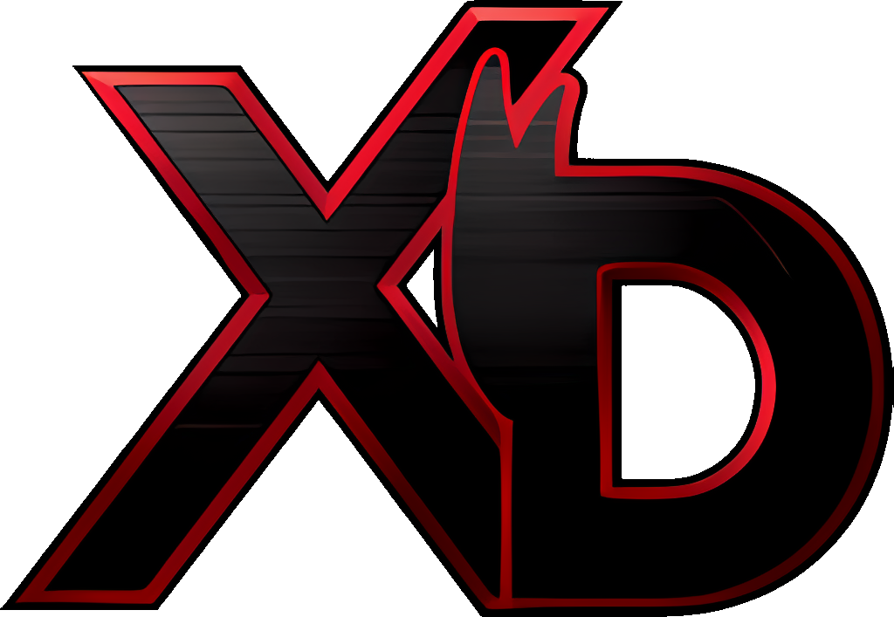
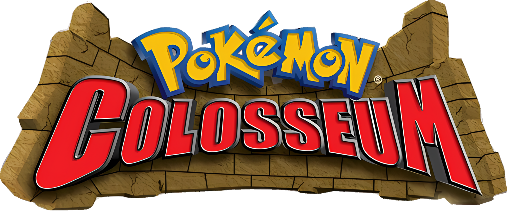

<p align="center">
  
  &nbsp;&nbsp;
  
</p>

# Dolphin XD and Dolphin Colosseum

Two Android builds of the [Dolphin](https://dolphin-emu.org) GameCube emulator. Each plays one game and behaves like a native game app.

| App | Game | Package | Look |
| --- | --- | --- | --- |
| **Dolphin XD** | Pokémon XD: Gale of Darkness (`GXX…`) | `com.logie.dolphinxd` | Dark theme in Shadow Lugia purple, red and black |
| **Dolphin Colosseum** | Pokémon Colosseum (`GC6…`) | `com.logie.dolphincollosseum` | Light desert theme in sand, terracotta and gold |

Both apps work the same way. There's no game list and no on-screen buttons: you play with taps and swipes anywhere on the screen. A themed main menu has texture pack and mod installers and Dolphin's emulator settings.

This repository also builds **V3 Gold** (`com.logie.v3gold`): Persona 4 Golden on the Vita3K PS Vita emulator, with the same kind of gesture controls and a Persona 4 Golden themed menu. It has its own workflow and releases. See [v3gold/README.md](v3gold/README.md).

## Getting the APKs

GitHub Actions (**Actions → Build APKs**) publishes each app as its own release on the repository's **Releases** page: **Dolphin XD 1.0.N** (tags `xd-build-N`) and **Dolphin Colosseum 1.0.N** (tags `colosseum-build-N`). On your phone, open the latest release of the app you want and tap its `.apk`.

A push only rebuilds and releases the apps whose files changed since their last release (`scripts/apps-to-build.sh` decides). A change to one game's files never publishes the other app. A change to the shared code (`overlay/`, `patches/`, the Dolphin version) releases both. To rebuild an app by hand, for example after changing build settings in the workflow, use **Run workflow** and pick the app. Pull request builds are checked but not published.

The two apps have different package names, so they install side by side as separate apps. Each keeps its own saves, settings, texture packs and mods in its own app storage. Installing or updating one never touches the other.

The first build takes about an hour because it compiles all of Dolphin. Later builds reuse a compiler cache.

### Updates

Each app checks this repository's releases for a newer build of itself every time it opens, before the game starts. You can also check by hand with **Check for updates** in the Dolphin menu, or the **Updates** tile on the main menu. If there's an update, the app asks whether to download it, then opens Android's installer. The first time, Android asks you to allow the app to install updates. Updates install over the app and keep your saves. Installing closes the app, so save your game first.

The app finds its releases through GitHub's API. That works without any setup for a public repository. For a **private** repository, the build needs a read-only token:

1. On GitHub, go to **Settings → Developer settings → Personal access tokens → Fine-grained tokens → Generate new token**.
2. Under **Repository access**, choose **Only select repositories** and pick this repository. Under **Permissions → Repository permissions**, set **Contents** to **Read-only**.
3. Set the longest expiration you're comfortable with. When the token expires, update checks stop working until you add a new token and install the next build by hand.
4. In this repository, add it under **Settings → Secrets and variables → Actions** as `DOLPHINXD_UPDATE_TOKEN`.

The token is built into the APK, so anyone who has the APK can extract it and read this repository. Keep the APKs to yourself, or make the repository public and skip the token.

The first build that includes the update check has to be installed by hand. Later builds come through the app.

## First launch

1. **Setup files (optional):** choose a GameCube BIOS (`IPL.bin`) dumped from your own console, or tap **Skip**. Neither game needs a BIOS. If you add one, the GameCube startup animation plays before the game.
2. **Game file:** choose your own disc image (`.iso`, `.gcm`, `.rvz`, `.ciso`, `.gcz` or `.wbfs`). Each app accepts only its own game in any region: `GXXE01`, `GXXP01` or `GXXJ01` for Dolphin XD, and `GC6E01`, `GC6P01` or `GC6J01` for Dolphin Colosseum.
3. Tap **Play**.

After that, opening the app goes straight into the game. Exiting the game (**Exit to main menu** in the Dolphin menu) opens the main menu. Back on the main menu closes the app.

The picture is always 4:3, the games' own shape. Dolphin's "Auto" setting kept switching between 4:3 and a letterboxed 16:9 picture. You can change it in **Emulator settings → Graphics → Aspect Ratio**.

The apps don't include any game or BIOS files. You have to provide your own.

## Controls

| Gesture | GameCube input |
| --- | --- |
| Tap | A, and speeds through text that's still printing (see below) |
| Hold | B (held for as long as your finger stays down) |
| Double-tap | Start |
| Tap, then tap and hold on the **left** half | L |
| Tap, then tap and hold on the **right** half | X |
| Swipe up, down, left, right or any angle in between, keeping your finger down | Control Stick, in that direction |
| The same swipe | Also the D-pad (up, down, left or right, whichever the swipe points closest to), held for as long as the swipe is |
| Hold one finger and swipe with another, in either order | Fast-forward: the game runs at double speed until you lift the held finger |
| Two-finger tap, then two-finger tap and hold | Dolphin menu |
| Pinch with two fingers | Zoom the 3D camera in (up to 2x) or back out |
| Two-finger double tap | Camera back to the game's own view |
| Three-finger tap | Quick save |
| Three-finger hold | Quick load |

While one finger is on the Control Stick, you can tap with a second finger for A. To hold B while walking, hold, then drag with the same finger.

### Speeding through text

In both games, pressing A while a line of text is still printing does nothing, and there's no instant-text option or code for them. Gecko codes crash both games. So each tap that presses A also runs the game at full speed for half a second, which fills in a printing line almost at once. The A press comes first. On a line that's still printing, the game ignores it and the line finishes fast. On a finished line, it moves to the next one, which then prints fast. A line you haven't read is never skipped. The burst also speeds up whatever else is on screen for that half second, and the music jumps ahead slightly. Turn it off with the switch at the bottom of **Controls** (main menu or Dolphin menu → **Gesture controls**).

### Camera zoom

Pinching zooms the game's 3D camera through Dolphin's Free Look field of view. It works in the overworld, battles and cutscenes. Menus and text are 2D and stay as they are. The zoom goes from the game's own view up to 2x and is remembered between sessions. A two-finger double tap puts it back. **Camera zoom** in the Dolphin menu sets the same zoom with a slider. It can't zoom out past the game's own view, because the games only draw what their camera sees and anything wider would show missing scenery at the edges.

### Quick save and quick load

A three-finger tap makes a quick save (a Dolphin save state) and a three-finger hold loads it. They share one slot with **Quick save** and **Quick load** in the Dolphin menu.

A save state also restores the memory card as it was when the state was made. Loading a quick save from before your last in-game save would undo that save and leave you with two different saves. So each save state remembers what was on the memory card when it was made. It only loads while the card is still exactly the same, which means you haven't saved in the game since. Otherwise it shows "Not loaded: you saved in the game after this quick save" and nothing changes. The same rule applies to the numbered save state slots in the Dolphin menu.

### 60 FPS

Both games normally run at 30 FPS. By default the apps run them at 60 FPS without speeding them up. They use the community 60 FPS codes that Dolphin ships for every region of both games (by Nerdzilla on Project Pokémon). To switch back to 30 FPS, use **Frame rate** on the main menu or in the Dolphin menu. A change takes effect the next time the game starts.

At 60 FPS the game's CPU does twice the work, so the app also sets Dolphin's emulated CPU to 200% while the game runs (only for that session, so your own settings stay as they are). This needs a fast phone, especially for Pokémon XD.

Known issues (from Dolphin's wiki and the code's author):

- A few cutscenes softlock at 60 FPS. **Unstick cutscene** (Dolphin menu → **Frame rate**) drops the game to 30 FPS for 10 seconds:
  - Colosseum: Rui walking into a wall when approaching the Mayor near the start. Use it any time while she's stuck.
  - Colosseum: Beluh going upstairs for the Stone Tablet, and Miror B leaving the room after his battle in Realgam. Use it just before the cutscene.
  - XD: Professor Krane's Master Ball cutscene. Use it just before continuing past the message box.
  - Quick save before these spots, just in case.
- A few moves can still drop frames.
- The codes were written for the original games. If a mod misbehaves at 60 FPS, switch it to 30 FPS.

### Graphics settings

The apps set these once. You can change any of them in **Emulator settings → Graphics**:

| Setting | Value | Why |
| --- | --- | --- |
| Internal resolution | 3x native (1920x1584) | Sharp on the Galaxy Z Fold 8's 1800-pixel-tall inner screen, and light enough on the GPU to leave the phone's thermal headroom for the CPU, which is the bottleneck at 60 FPS |
| Shader cache | On (Dolphin's default) | Each shader compiles once and is saved. Later starts load the saved shaders in the background, with no compiling screen |
| Aspect ratio | Force 4:3 | Dolphin's wiki fix for the picture switching between 4:3 and 16:9 |

Everything else stays at Dolphin's defaults on purpose: the OpenGL ES backend, synchronous shader compilation, the game's own texture filtering, and no "Compile shaders before starting". That setting rebuilt every saved shader before each start, so every launch had to wait. Version 1.0.14 used Vulkan, Hybrid Ubershaders and forced 16x anisotropic filtering, which corrupted textures on Snapdragon (Adreno) GPUs. Logos and menu borders turned into colored noise. Adreno drivers are known to mishandle Dolphin's ubershaders. Later versions put these settings back.

Dolphin's own per-game settings stay in place for both games, and the apps don't override them. They fix garbled text with the safe texture cache, and they keep Pokémon XD on single core with MMU emulation so it doesn't crash.

### Fast-forward and sound

During fast-forward the sound keeps playing at normal speed and pitch. The game makes two seconds of sound every second, so not all of it can be played. The app's change to Dolphin's audio mixer lets up to about a second of sound queue up and plays it at normal speed. Once the queue is full, it skips ahead by half a second at a time. When you let go, it jumps straight back to the game's current sound. As a result, sound effects can lag the picture by up to a second while fast-forwarding, but music and voices never speed up or sound chipmunked.

How close fast-forward gets to double speed depends on the phone. If the phone can't run the game that fast, it runs as fast as it can.

The D-pad turns on once the swipe is about halfway to full tilt, so menus that only follow the D-pad work with the same swipe. Once a direction is pressed, it stays pressed until the swipe clearly turns away, so a diagonal or wobbly swipe doesn't flicker between two directions. A quick flick still holds the D-pad for 100 ms so the game sees it.

The Dolphin menu has Pause, save states, Dolphin's full **Settings**, **Gesture controls** (this table), **Frame rate**, **Camera zoom**, **Check for updates** and **Exit to main menu**. The Back button opens the same menu. Bluetooth and USB game controllers also work.

## Main menu

| Button | What it does |
| --- | --- |
| **Play** | Starts the selected game version |
| **Texture packs** | Imports, enables, disables and deletes texture packs, and turns Load custom textures and Prefetch on or off |
| **Mods** | Installs mods and picks the version Play starts (the original game or a mod) |
| **Emulator settings** | Dolphin's full settings: graphics, audio, controllers and more |
| **Frame rate** | 60 FPS (default) or the original 30 FPS |
| **Controls** | The gesture guide |
| **Updates** | Checks for a newer version and installs it (see [Updates](#updates)) |
| **Change game file** | Runs the game-file setup again |
| **Exit** | Closes the app |

### Texture packs

Tap **Import pack (.zip)** and choose the pack's zip as downloaded. The importer handles both layouts Dolphin packs come in:

- **Texture packs** contain a folder named after the game ID: `GXX` or `GXXE01` for XD, `GC6` or `GC6E01` for Colosseum.
- **Dolphin resource packs** contain `textures/<game ID>/…` and a `manifest.json`.

If a zip won't open, extract it with a file manager and use **Import extracted folder**.

[Pokémon XG/XD HD Texture Pack](https://forums.dolphin-emu.org/Thread-pokemon-xg-xd-hd-texture-pack-v1-0) and Pokémon Colosseum HD packs install this way. If a pack comes in PNG and DDS versions, use PNG on phones: Dolphin only shows DDS textures on GPUs that support BC texture compression. Most Snapdragon (Adreno) GPUs do; Mali (Exynos, Tensor, MediaTek) GPUs don't.

Each pack gets its own folder in `Load/Textures` with a marker file named after the game (`GXX.txt` or `GC6.txt`). Dolphin loads every folder that has the marker, which is how a pack is switched on or off without deleting it.

### Mods

Tap **Install mod patch (.ups)** and choose the patch. The app follows the mod's own instructions: it applies the patch to a clean copy of your original disc image and never changes your original file. The result is a separate game version. The patch's checksums confirm that the base image is the exact one it was made for.

When a mod is already installed, the app asks what to apply the patch to:

- **The clean original:** for new mods and for updates. Mod authors say to always patch updates onto a clean ISO.
- **An installed mod:** for add-ons made for that mod. The mod is updated in place.

| Mod | What to do |
| --- | --- |
| [Pokémon XG: Next Gen](https://projectpokemon.org/home/forums/topic/37672-pokemon-xg-next-gen/) (Dolphin XD) | Install the `.ups` patch. It needs the **USA** Pokémon XD (GXXE01). |
| [Pokémon Grand Colosseum](https://projectpokemon.org/home/files/file/4623-pokemon-grand-colosseum/) (Dolphin Colosseum) | Install the `.ups` patch of the version you want (Johto, Kanto or Hoenn). It needs the **USA** Pokémon Colosseum (GC6E01). For the Nuzlocke patch, install it afterwards and choose your Grand Colosseum version when asked. |

Both mods need a full 1.46 GB ISO of the USA game. RVZ, GCZ and WIA images are converted to ISO automatically first. NKit images can't be used, because NKit trims the disc. Patching needs about 1.5 GB of free space.

**Add already-patched game** adds a modded ISO that was patched somewhere else, for mods that ship as xdelta or other formats.

Each game version keeps its own memory card saves and save states. These mods use the same game ID as the original, so without this the original and the mod would overwrite each other's saves.

## How this fork is built

Dolphin's full source is too large to vendor, so this repository holds only the changes, and CI applies them to a pinned upstream release:

| Path | Contents |
| --- | --- |
| `dolphin-version.env` | The upstream Dolphin release (tag and commit) to build from |
| `patches/` | Changes to Dolphin's own files: configurable package name, the app's screens, gesture input in the emulation screen, in-game menu entries, the themed palette, normal-speed audio during fast-forward, save state checks in the Dolphin menu, update checks, frame rate in the Dolphin menu, pinch zoom |
| `overlay/` | Code and layouts shared by both apps: setup and main menu screens, texture pack and mod installers, UPS patcher, gesture controls |
| `games/<game>/` | One app each (`xd`, `colosseum`). `game.env` sets the package and name. `overlay/` holds that game's wording, game ID, colors and artwork. `branding/` holds the source images. |
| `scripts/prepare-dolphin.sh` | Clones Dolphin, applies `patches/`, then copies `overlay/` and `games/<game>/overlay/` |
| `scripts/generate-art.sh` | Rebuilds a game's launcher icons, splash and menu artwork from its `branding/` |
| `scripts/apps-to-build.sh` | Lists the apps that changed since their last release. CI builds and releases only those. |
| `unit-tests/` | JVM unit tests for the gesture recognizer and the UPS patcher. CI runs these before the APK builds. |

To build locally, you need JDK 21 and the Android SDK, plus the NDK version named in Dolphin's `build.gradle.kts`:

```sh
XD="$PWD"                                   # this repository
GAME=colosseum                              # or xd
scripts/prepare-dolphin.sh "$GAME"          # creates build/dolphin
source "games/$GAME/game.env"
cd build/dolphin/Source/Android
./gradlew assembleRelease -PxdVersionCode=1 -PxdVersionName=1.0.1 \
  -PxdApplicationId="$APP_ID" -PxdAppName="$APP_NAME" \
  -Pkeystore="$XD/ci/dolphinxd-ci.p12" -Pstorepass=dolphinxd -Pkeyalias=dolphinxd -Pkeypass=dolphinxd
```

To add another game, copy `games/colosseum`, change `game.env`, the strings and colors in its `overlay`, and the images in `branding/`. Give it its own `RELEASE_TAG_PREFIX` in `game.env`. Then run `scripts/generate-art.sh <game>` and add the game to the `app` choices in `.github/workflows/build-apk.yml`. CI picks up new games automatically.

To update Dolphin, change `dolphin-version.env` and run `scripts/prepare-dolphin.sh`. If a patch no longer applies, fix it in `build/dolphin`, commit the fix there, and regenerate the patches with `git format-patch --zero-commit --no-signature -o ../../patches <old tag>..HEAD~1`.

## Signing

Android only installs an update over an existing app if both are signed with the same key. By default CI signs both apps with `ci/dolphinxd-ci.p12` (password `dolphinxd`). That key is committed, so every build installs over the last one. It also means anyone can sign an APK with it, so only install builds from this repository.

To sign with a private key instead, add these repository secrets (**Settings → Secrets and variables → Actions**):

- `DOLPHINXD_KEYSTORE_BASE64`: your keystore, base64-encoded (`base64 -w0 my.keystore`)
- `DOLPHINXD_KEYSTORE_PASSWORD`
- `DOLPHINXD_KEY_ALIAS`
- `DOLPHINXD_KEY_PASSWORD`: optional, defaults to the keystore password

Switching keys changes the apps' signatures. Uninstall the old builds first, which deletes saves, or back up `Android/data/<package>` before switching.

## License

Dolphin is licensed under GPLv2+. This fork, including everything in `patches/`, `overlay/` and `games/`, uses the same license. Pokémon is a trademark of Nintendo, Creatures Inc. and GAME FREAK inc. This project isn't affiliated with any of them or with the Dolphin team.
