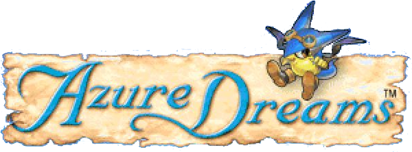

<p align="center">
  
</p>

# Azure Dreams

An Android app that plays one game: **Azure Dreams** for the PlayStation. It runs on [SwanStation](https://github.com/libretro/swanstation), libretro's GPL fork of DuckStation, through [LibretroDroid](https://github.com/Swordfish90/LibretroDroid). SwanStation draws with the phone's GPU (OpenGL ES), at 4× the PlayStation's resolution by default. You play with taps and swipes anywhere on the screen, from a title screen styled after PlayStation-era menus. A **2D-HD** picture gives it the look of Octopath Traveler.

| | |
| --- | --- |
| Package | `com.logie.azure` |
| Releases | **Azure Dreams 1.0.N**, tags `ad-build-N` (**Actions → Build Azure Dreams**) |
| Emulator | SwanStation, built for arm64 from the commit in `core-version.env` |

Why not DuckStation itself: its license (CC BY-NC-ND, now PolyForm Strict) doesn't allow modified versions to be shared, and its Android app's source isn't public. SwanStation is the libretro core forked from DuckStation while it was GPL, kept up by the libretro team. The app ran on PCSX ReARMed before; that core only draws in software, at up to 2× the resolution.

## First launch

1. Open the app and tap **Choose files** (or the **Disc** tile).
2. Pick your Azure Dreams disc image: the `.cue` file and its `.bin` files together, or a single `.chd`, `.pbp` or `.iso`. The app copies it into its own storage, so you can delete the original afterwards.
3. Tap **PRESS START**.

Add a BIOS dumped from your own PlayStation (`scph1001.bin`, `scph5501.bin` and the like, 512 KB, any region): **Add BIOS** on the title screen, or the **BIOS** tile. The game boots without one, on OpenBIOS (a free BIOS SwanStation carries), but the game's own memory card saves are only known to work with a real BIOS: on PCSX ReARMed's stand-in, Azure Dreams froze when it saved. Save states work either way.

A save state carries the BIOS it was made on in the game's memory: the app points it out when you load a slot made before you added yours.

After that, opening the app goes straight into the game once it has checked for updates. The game always starts fresh, at its own title screen: load your save from the memory card there.

## Controls

The gestures are V3 Gold's, with the D-pad in place of the sticks: Azure Dreams only uses the digital pad.

| Gesture | Button | In Azure Dreams |
| --- | --- | --- |
| Swipe anywhere | D-pad, any of 8 directions, held while the finger stays down | Walk, pick in menus |
| Tap | Cross | Attack, OK |
| Hold | Circle, held | Cancel |
| Hold, then drag (or hold and swipe with another finger) | Circle + D-pad | Run |
| Hold, and tap with another finger (again and again while you hold) | Triangle, with Circle still held | |
| Tap, then tap and hold | R1 on the right half of the screen, L1 on the left, held | Turn the view |
| Two fingers swipe down | Square | The game's menu |
| Two fingers swipe up | Triangle | Jump |
| Two fingers swipe right / left | L1 / R1 | |
| Double tap | Start | Pause |
| Two-finger hold | Select, held | Map |
| Two-finger tap, then two-finger tap and hold | This app's menu | |
| Android's back gesture | This app's menu | |

A swipe presses the D-pad as soon as it starts and follows the finger: the start point is dragged along about 6 mm behind it, so the D-pad points where the finger last moved and turning around is instant. Moving back to the start point lets go. A tap waits a quarter of a second before it presses Cross, to tell it apart from a double tap. While one finger walks, a second can tap for Cross or hold for Circle. While a finger holds Circle (running too), taps with another finger are Triangle instead of Cross.

A game controller works too; plug it in or pair it and play.

## In-game menu

Back gesture or the two-finger menu gesture. The game pauses while it's open.

- **Save state / Load state**: three slots. A state keeps the exact moment, anywhere, even inside the tower. The game's own saves are on the memory card and aren't touched by states.
- **Speed**: 1×, 2× or 3× (fast forward).
- **2D-HD**: on or off, and its effects (below).
- **Picture**: **Resolution** (1× to 8× the PlayStation's, 4× to start with: 1280 × 960), **Steady 3D** (PGXP: no wobbling polygons or warping textures), and sharp pixels, smooth, CRT TV scanlines or upscaled.
- **Controls**: the gesture guide and the vibration switch.
- **Reset game**, **Check for updates**, **Quit to title**.

Switching apps or the phone sleeping pauses the game where it is. Closing the app or **Quit to title** ends it: the next start boots the game fresh to its title screen. Save in the game (or in a save state slot) before closing.

## 2D-HD

**2D-HD** in the in-game menu gives the game the look of Square Enix's HD-2D games (Octopath Traveler, Triangle Strategy): its pixel sprites in a 3D world are made for it. While it's on, it takes the place of the Picture choice; switching it off goes back to that choice.

- The pixels stay sharp.
- **Depth of field** (Off, **Light**, Strong): tilt-shift blur, so the far top and the near bottom of the scene go soft and the middle, where Koh is, stays in focus.
- **Glow**: bright light blooms softly.
- The colors are graded (richer, warm light and cool shade) and the corners darkened.
- **Drifting light**: specks of warm light floating up through the scene.

The interface stays sharp on top of the effects, as if they were under it. A filter over the finished picture can't tell the game's menus from its world, so the 2D-HD shader looks for them: Azure Dreams' white lettering on the dark blue fill of its windows, and the deep navy of the tower's gauges. Text, windows and the gauges stay sharp and don't glow, and the strip with the gauges stays sharp in the tower. While someone is talking, the dialogue window along the bottom stays sharp from a little above its first line down, with its name plate and the speaker's portrait on the left, and the rest of the scene keeps its depth of field. The drifting light stays between the gauges and the dialogue window. If you spot something it gets wrong, a screenshot helps tune it.

It works the same at any resolution: the effects are worked out at the PlayStation's resolution.

## Saves

The game saves to memory card 1, which the app keeps in `saves/duckstation_shared_card_1.mcd` in its storage: it's written within a few seconds of the game saving, and whenever the game pauses (leaving the app, the in-game menu), so a save is kept even if the app is closed right after. The first change in a session keeps the card it replaces as a backup (`.backup`).

Save states and the memory card stay when the app updates and when you replace or delete the disc. Save states from the PCSX ReARMed versions don't load on SwanStation; they're kept, renamed `.pcsx`, in the app's `states/` folder.

## Updates

Like the other apps: the app checks this repository's releases (`ad-build-N`) when it opens and from **Check for updates**, and installs over itself. A private repository needs the `DOLPHINXD_UPDATE_TOKEN` secret (see the main README). It's signed with the same key as the other apps.

## How it's built

| Path | Contents |
| --- | --- |
| `app.env` | Package, app name and release tag prefix |
| `core-version.env` | The SwanStation commit to build |
| `libretrodroid-version.env` | The LibretroDroid commit to build (its 0.14.0 release) |
| `patches/libretrodroid/` | Changes to LibretroDroid: the 2D-HD shader, building with newer NDKs, and what SwanStation needs (OpenGL ES contexts only, a framebuffer that follows the frames' size, putting the core's OpenGL state back before drawing its frame) |
| `android/` | The app (`app/`): title screen, game screen, in-game menu, gestures, update checker. `libretrodroid/` builds LibretroDroid from `libretrodroid/upstream/`. |
| `branding/` | Source images. `make-icons.py` rebuilds the launcher icon layers from `icon.png`. |
| `fonts/` | Licenses of the pixel fonts (Press Start 2P, Pixelify Sans), both SIL Open Font License |
| `unit-tests/` | JVM unit tests for the gesture recognizer and the update picker |
| `../scripts/build-swanstation.sh` | Fetches SwanStation and builds it with the NDK, CMake and Ninja into `android/core/` |
| `../scripts/prepare-libretrodroid.sh` | Fetches LibretroDroid and its submodules into `android/libretrodroid/upstream/` and applies `patches/libretrodroid/` |

To build locally, you need JDK 17+ and the Android SDK with NDK 29.0.14206865 and CMake 3.31.6:

```sh
ANDROID_NDK_HOME="$ANDROID_HOME/ndk/29.0.14206865" CMAKE="$ANDROID_HOME/cmake/3.31.6/bin/cmake" \
  NINJA="$ANDROID_HOME/cmake/3.31.6/bin/ninja" scripts/build-swanstation.sh
scripts/prepare-libretrodroid.sh
cd azuredreams/android
./gradlew assembleRelease -PadVersionCode=1 -PadVersionName=1.0.1 \
  -Pkeystore="$PWD/../../ci/dolphinxd-ci.p12" -Pstorepass=dolphinxd -Pkeyalias=dolphinxd -Pkeypass=dolphinxd
```

To update the core, change the commit in `core-version.env`. To update LibretroDroid, change `libretrodroid-version.env` and run `scripts/prepare-libretrodroid.sh`; if a patch no longer applies, fix it in `android/libretrodroid/upstream`, commit there, and regenerate the patches with `git format-patch --zero-commit --no-signature -o ../../../patches/libretrodroid <old commit>`.

## License

The app is GPLv3 (LibretroDroid's and SwanStation's license). OpenBIOS, inside SwanStation, is MIT. The fonts are under the SIL Open Font License (`fonts/`). Azure Dreams is a trademark of Konami. This project isn't affiliated with Konami, the SwanStation or DuckStation teams, or LibretroDroid.
