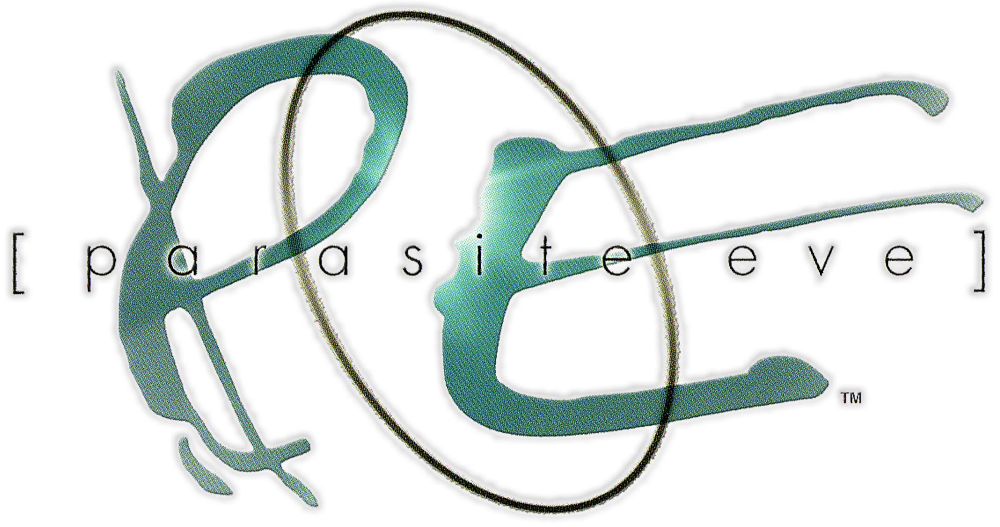

<p align="center">
  
</p>

# Parasite Eve

An Android app that plays one game: **Parasite Eve** for the PlayStation. It runs on [SwanStation](https://github.com/libretro/swanstation), libretro's GPL fork of DuckStation, through [LibretroDroid](https://github.com/Swordfish90/LibretroDroid). SwanStation draws with the phone's GPU (OpenGL ES), at 4× the PlayStation's resolution by default. You play with taps and swipes anywhere on the screen. The title screen is styled after the game's New York at night: Aya on the shore, the logo, and a river skyline under film grain.

| | |
| --- | --- |
| Package | `com.logie.pe` |
| Releases | **Parasite Eve 1.0.N**, tags `pe-build-N` (**Actions → Build Parasite Eve**) |
| Emulator | SwanStation and LibretroDroid as the [Azure Dreams app](../azuredreams/README.md) builds them |

## First launch

1. Open the app and tap **Choose files** (or the **Discs** tile).
2. Pick your Parasite Eve discs: the `.cue` and `.bin` files of both discs together, or a `.chd`, `.pbp` or `.iso` file for each. The app tells the discs apart by their names ("Disc 1", "CD2", ...) and copies them into its own storage, so you can delete the originals afterwards. Disc 2 can wait: **Add disc 2** on the title screen, or the **Discs** tile, adds it later.
3. Tap **[ press start ]**.

A `.pbp` with both discs in it (made for the PSP) works too: it takes both places.

Add a BIOS dumped from your own PlayStation (`scph1001.bin`, `scph5501.bin` and the like, 512 KB, any region): **Add BIOS** on the title screen, or the **BIOS** tile. The game boots without one, on OpenBIOS (a free BIOS SwanStation carries), but the game's own memory card saves are only known to work with a real BIOS. Save states work either way.

After that, opening the app goes straight into the game once it has checked for updates. The game always starts fresh, at its own title screen: load your save from the memory card there.

## Disc 2

At the end of disc 1 the game saves and asks for disc 2. Open this app's menu (back gesture, or the two-finger menu gesture) and pick **disc 2** next to **Disc**: the lid opens, disc 2 goes in and the lid closes, as on a PlayStation. The same row puts disc 1 back.

The app starts the game from a playlist of the installed discs (`game/Parasite Eve.m3u`), so both are in the emulator's disc tray from the start. A save state remembers the disc that was in, and loading it puts that disc back.

## Controls

The gestures are Azure Dreams', with Triangle, Parasite Eve's menu, on the double tap.

| Gesture | Button | In Parasite Eve |
| --- | --- | --- |
| Swipe anywhere | D-pad, any of 8 directions, held while the finger stays down | Walk, pick in menus |
| Tap | Cross | Examine, talk, OK; in battle, carry out the command |
| Hold | Circle, held | Cancel |
| Hold, then drag (or hold and swipe with another finger) | Circle + D-pad | Run |
| Hold, and tap with another finger (again and again while you hold) | Triangle, with Circle still held | |
| Tap, then tap and hold | R1 on the right half of the screen, L1 on the left, held | Scroll menus |
| Double tap | Triangle | The menu |
| Two fingers swipe up | Square | Skip the battle command |
| Two fingers swipe right / left | L1 / R1 | Scroll menus up / down |
| Two fingers swipe down | Start | Pause |
| Two-finger hold | Select, held | |
| Two-finger tap, then two-finger tap and hold | This app's menu | |
| Android's back gesture | This app's menu | |

A swipe presses the D-pad as soon as it starts and follows the finger: the start point is dragged along about 6 mm behind it, so the D-pad points where the finger last moved and turning around is instant. Moving back to the start point lets go. A tap waits a quarter of a second before it presses Cross, to tell it apart from a double tap. While one finger walks, a second can tap for Cross or hold for Circle. While a finger holds Circle (running too), taps with another finger are Triangle instead of Cross.

A game controller works too; plug it in or pair it and play.

## In-game menu

Back gesture or the two-finger menu gesture. The game pauses while it's open.

- **Save state / Load state**: three slots. A state keeps the exact moment, anywhere, even mid-battle. The game's own saves are on the memory card and aren't touched by states.
- **Speed**: 1×, 2× or 3× (fast forward). The sound keeps its pitch: it's time-stretched to the game's speed rather than played back faster.
- **Disc**: which disc is in (once both are added).
- **Picture**: **Resolution** (1× to 8× the PlayStation's, 4× to start with: 1280 × 960), **Steady 3D** (PGXP: no wobbling polygons or warping textures), and sharp pixels, smooth, CRT TV scanlines or upscaled. The resolution sharpens Aya and the creatures; the backgrounds are pre-drawn pictures and keep their own.
- **Controls**: the gesture guide and the vibration switch.
- **Reset game**, **Check for updates**, **Quit to title**.

Switching apps or the phone sleeping pauses the game where it is. Closing the app or **Quit to title** ends it: the next start boots the game fresh to its title screen. Save in the game (or in a save state slot) before closing.

## Saves

The game saves to memory card 1, shared by both discs, which the app keeps in `saves/card1.mcd` in its storage: it's written within a few seconds of the game saving, and whenever the game pauses (leaving the app, the in-game menu), so a save is kept even if the app is closed right after. The first change in a session keeps the card it replaces as a backup (`.backup`). The **Memory card** tile imports a card from another emulator or a PlayStation and exports a copy.

Save states and the memory card stay when the app updates and when you replace or delete a disc.

## Updates

Like the other apps: the app checks this repository's releases (`pe-build-N`) when it opens and from **Check for updates**, and installs over itself. A private repository needs the `DOLPHINXD_UPDATE_TOKEN` secret (see the main README). It's signed with the same key as the other apps.

## How it's built

The emulator is the Azure Dreams app's build, shared rather than copied: `scripts/build-swanstation.sh` builds SwanStation into `azuredreams/android/core/`, and `scripts/prepare-libretrodroid.sh` prepares LibretroDroid in `azuredreams/android/libretrodroid/`, both with `azuredreams/patches/` (among them: OpenGL ES contexts only, fast forward's time-stretched sound, and the disc in after a state load reported to the app). This app's Gradle build uses both from there.

| Path | Contents |
| --- | --- |
| `app.env` | Package, app name and release tag prefix |
| `android/` | The app (`app/`): title screen, game screen, in-game menu, gestures, discs, update checker |
| `branding/` | Source art: the header (`header.jpg`) and the logo. `make-icons.py` makes the launcher icon from the header, centered on Aya's face, and the themed icon from the logo's "PE". |
| `fonts/` | License of Jost, the typeface (SIL Open Font License) |
| `unit-tests/` | JVM unit tests for the gesture recognizer, the update picker and sorting picked files into discs |

To build locally, you need JDK 17+ and the Android SDK with NDK 29.0.14206865 and CMake 3.31.6:

```sh
ANDROID_NDK_HOME="$ANDROID_HOME/ndk/29.0.14206865" CMAKE="$ANDROID_HOME/cmake/3.31.6/bin/cmake" \
  NINJA="$ANDROID_HOME/cmake/3.31.6/bin/ninja" scripts/build-swanstation.sh
scripts/prepare-libretrodroid.sh
cd parasiteeve/android
./gradlew assembleRelease -PpeVersionCode=1 -PpeVersionName=1.0.1 \
  -Pkeystore="$PWD/../../ci/dolphinxd-ci.p12" -Pstorepass=dolphinxd -Pkeyalias=dolphinxd -Pkeypass=dolphinxd
```

## License

The app is GPLv3 (LibretroDroid's and SwanStation's license). OpenBIOS, inside SwanStation, is MIT. Jost is under the SIL Open Font License (`fonts/`). Parasite Eve is a trademark of Square Enix; its art belongs to Square Enix. This project isn't affiliated with Square Enix, the SwanStation or DuckStation teams, or LibretroDroid.
