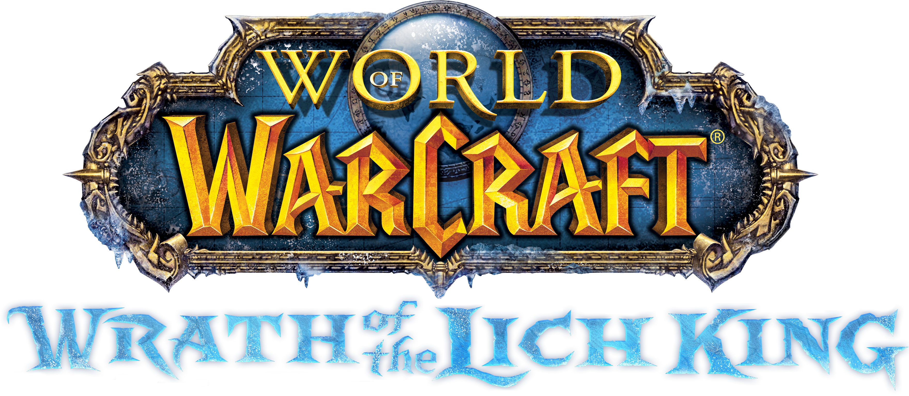

<p align="center">
  
</p>

# World of Warcraft

An Android app for **World of Warcraft: Wrath of the Lich King 3.3.5a** that plays the game on the phone, your own 3.3.5a client run by Wine, Box64 and the phone's GPU inside the app, with its own private realm on the phone: a [ChromieCraft](https://www.chromiecraft.com/)-style [AzerothCore](https://www.azerothcore.org/) server with [playerbots](https://github.com/mod-playerbots/mod-playerbots), running natively on the phone's arm64 processor next to its MariaDB database. The launcher is styled after Wrath's Northrend: the Lich King before Icecrown Citadel with snow drifting across, the logo, and frost-blue panels with gold corners.

Two realms live in the app, one at a time, with the same accounts: **ChromieCraft**, and **Wrath Remix**, a Legion Remix-style replay of Northrend from level 10 with Moratari and the Infinite Dragonflight (see "Wrath Remix" below).

It's being built in stages (see [`PLAN.md`](PLAN.md)). **Stage 1, done:** the launcher and the server; a PC's 3.3.5a client on the same Wi-Fi can play on the realm. **Stage 2, this version:** the game itself in the app, started from the launcher straight to its login screen on the realm, with touch gestures (tap to click, swipe to walk, hold for bags, double tap to jump). **Stage 3:** every server option in the launcher (progression brackets, rates, realm settings), bot management, add-ons, controls and graphics settings.

| | |
| --- | --- |
| Package | `com.logie.warcraft` |
| Releases | **World of Warcraft 1.0.N**, tags `wow-build-N` (**Actions → Build World of Warcraft**) |
| Server | AzerothCore at the revision ChromieCraft runs, with the playerbots fork's core changes merged in, ChromieCraft's modules and mod-playerbots, built for Linux arm64 (musl) from the commits in `server-version.env`, and this repository's `mod-wrath-remix` (`modules/`) |
| Realms | ChromieCraft (realm 1, port 8085) and Wrath Remix (realm 2, port 8086): one auth server and set of accounts, each realm its own world server, configs and databases |
| Server data | AzerothCore's ready-made data, downloaded in the app (the version in `server-data.env`), or made from your client |
| Client | Yours: World of Warcraft 3.3.5a (build 12340), enUS. Never part of the app. |
| Game runtime | Wine, Box64, DXVK, the Vortek and Gladio graphics drivers and an X server, from Winlator 11.2's code compiled into the app (no Winlator app, screens or settings; see "How it's built") |

## First launch

### Legion — 7.3.5 (LegionCore)

**Games → Legion 7.3.5** is World of Warcraft: Legion 7.3.5 (build 26972) against a LegionCore
realm on the phone (The Legion Preservation Project's core), set up and run the way the 3.3.5a
game's ChromieCraft realm is: the realm's programs are native Android (arm64) programs with their
own MariaDB, and the game is your client on the app's Windows runtime, in a Windows of its own
(the container "Felsong"). The code and folders keep the name Felsong (`files/felsong`), from when
this game was planned as Felsong's realm. The Single Player Project setup is no longer in the
picker; its files (`files/spp-legion`) stay until Legion takes them (below).

**Press start** does the next thing missing, one at a time: it downloads and installs the realm
(LegionCore's programs, its database with the world and hotfixes, about 110 MB to download and
1.5 GB on the phone, checked against its SHA-256), then takes what the Single Player Project
download left on the phone, if it's there, then starts the realm and the game. The numbered steps
(**Steps**) show the same, from nothing to Play.

**The Legion files already on the phone.** If the Single Player Project download is on the phone
(its client and its server data, about 48 GB), **Use them** (or Press start) moves them into
Legion's folder: one rename each on the same storage, nothing downloaded or copied again (from SPP's
other storage they're copied, and SPP's copy stays). SPP's patched program becomes the client's
patched program (it carries the TrinityCore Battle.net key LegionCore's login server has too), and
the certificate bundle it trusts is the app's. SPP's server data (dbc, maps, vmaps, mmaps,
cameras, gt) was made by AshamaneCore's extractors in the formats LegionCore reads (maps v1.9 with
the same header, VMAP_4.8, mmaps version 9; checked file by file against LegionCore's source, not
yet by a world server on a phone). What Legion has already stays. After this SPP no longer has
them.

**Without them:** **Game files → Your client** copies your own 7.3.5 client in (a folder or a zip),
the server's data is made from it on the phone (minutes for the maps and DB2 tables, more for the
vmaps, hours for pathfinding if chosen), or imported as a zip made on a PC, and LegionCore's
connection patcher makes `Wow-64_Patched.exe` for the realm.

**The game** starts with the Box64 build that gets Legion's client through its start-up protection
(0.4.4-legion: Box64's fix for the flags of single-stepped instructions, box64 #3061; the stock
Box64 gives "Game Initialization Failed!"). Its graphics API is **Direct3D 9** first (the phone's
3.3.5a game draws through DXVK's Direct3D 9), on its command line and in Config.wtf (kept with
`videoOptionsVersion` 15); when a launch's own `Logs/gx.log` says its graphics didn't start, the
next launch uses Direct3D 11, then OpenGL. The client's language is English (US), its portal this
phone. The realm's ports are its own (database 3312, Battle.net 1119, its REST login 8081, world
8095 and 8096): it runs beside the other games' realms.

**Game options** (a tile): small changes to the game, each a switch, more than an add-on can do and
much less than a module. They're settings of the realm's (`App.*` in `files/felsong/etc/worldserver.conf`,
read by the app's patch of LegionCore), written at every start, so a switch takes effect at the
realm's next start; your client's files don't change.

- **Unlock allied races:** Nightborne, Highmountain Tauren, Void Elves and Lightforged Draenei at
  character creation from the start, with no reputation or quest first.
- **Unlock all classes:** death knights and demon hunters from the start, with no character of 55
  (or 70) on the account first.
- **Undead paladins:** Paladin as a class for the Forsaken at character creation. The realm adds the
  pair to the game's race and class table (sent as a hotfix), gives them the undead warrior's start
  in Deathknell and the blood elf paladin's action bars, and, with no undead paladin outfit in the
  game, another race's paladin outfit. They train at the priest trainers (in Undercity, Deathknell,
  Brill...), who offer them a paladin trainer's lessons (LegionCore patch 0010).
- **No underwear:** the realm sends the game its character table's underwear rows without their
  textures (as hotfixes), so the skin shows where nothing is worn. Switching it (or Undead paladins) clears the
  game's cache of such rows (`client/Cache`) at the realm's next start.

**Add-ons** (a tile): the same add-on manager as the other games', from
[warperia.com's Legion 7.3.5 list](https://warperia.com/legion-addons/), or zips on the phone, into
Legion's client (`Interface/AddOns`). The game loads add-ons whatever version they say they're for.

**On the Galaxy Z Fold 8:** the game runs at up to 60 frames a second (5 behind other apps). Its
first start uses Legion's "Fair" preset in the world (3), the lowest in raids, no anti-aliasing,
full render scale and no vsync; what you change in the game's options stays. The warning about
the graphics API (Direct3D 9) isn't shown: the client's configuration warnings are marked seen.

**Apart from the other games.** Only one Windows game screen is open at a time; otherwise nothing
of Legion touches the other games' files, realms or accounts, and theirs don't touch Legion's.

**Legion on a phone is unverified.** The realm's package is built, started and logged into by CI
on an arm64 machine (database, Battle.net login with an app-made account, the world server's
database updates); the world server with real data, and the client drawing and playing on a
phone, have not been run anywhere yet.

### The War Within — 11.2.5

Choose **Games → The War Within — 11.2.5**. Its home screen follows the other realms:
illustrated header, music switch, **Press Start**, and tiles for Server, Game Files, Graphics,
App Icon, Updates and Games. Files and saves stay separate from the other expansions.

Tap **Download & Install**. The app downloads and extracts the publisher’s Firestorm streaming
mini-client, Draconic server repack and additional maps, then configures **127.0.0.1**. No browser,
computer or manual import is required. The client archive is about 63 MB; the game downloads its
remaining assets during play, so internet access and additional storage are required. This is
not a complete offline client. Its inspected Windows executable is **11.2.5.63704**; the app pins
the archive’s size and SHA-256 and checks the executable’s version and digest.

Real progress, transfer speed and estimated time appear during downloads. **Pause installation**
keeps supported partial downloads; **Resume / Retry** continues after an interruption. Completed
components are reused. Downloaded files stay separate from installed files, and replacement files
are staged and validated before placement. ZIP, 7z (including BCJ2) and RAR extract automatically.
Drive permission, quota, unavailable links, damaged archives and disk-space errors are reported.
No game downloads are bundled in the APK or repository.

Once installed, **Press Start** starts the database, authentication and world server, checks the
authentication database for build 63704, and launches the game when the local realm is ready.
**Server** shows each component’s actual status and separate Start, Stop and Launch controls.
Draconic’s bundled `core/old` database is kept as a backup; setup uses Uniform Server’s active
`core/mysql` daemon, tools and data. If an older app reported ambiguous database files, tap
**Download & Install** again after updating to finish setup using your existing files.

Active downloads and Windows game/server sessions continue when you press Home, switch apps or
lock the screen. Their foreground notifications remain available while work is active. Downloads
keep their original restart intent so Android can resume interrupted work using validated cached
files. **Server → Background activity → Allow background activity** opens Android’s battery
setting if your phone restricts background work. Explicit Pause, Stop Server and Exit still work;
Android Force Stop ends background work. A cancelled screen refresh is not an installation error.
Startup fails with details if the downloaded repack or phone runtime is incompatible.

**Game Files** shows Game Client, Server Core, Server Database and Map Files separately.
**Verify Installation** reports missing or changed recorded files. **Advanced / Storage** lets
you choose internal or external app storage before installing, clear temporary downloads,
re-download individual components, view sources or optionally import existing files. A normal
install preserves an existing server/database; explicitly reinstalling the server replaces it,
so back up characters and accounts first. Local setup backs up text configurations and never
patches executables. Installing a client/repack uses the executables supplied by that download.

The Windows server and game share the existing Wine/Box64 runtime in a dedicated container.
The repack and client have not been run on a real phone here. Streamed asset availability and
Firestorm-specific authentication compatibility still depend on the supplied client and services.
[`TWW.md`](TWW.md) records source verification and runtime constraints. This integration does not
claim that Blizzard’s Legion Remix event is implemented by the repack.

### Wrath of the Lich King

1. Install the APK from the release page on the phone.
2. Open the app. The first **Press start** unpacks the server and creates its databases (a few minutes, once), then starts the login server. The world server waits for the server's data.
3. Get the server's data, once (**Game files**). One of:
   - **Download (the quick way):** **Download server data** gets AzerothCore's ready-made data: dbc, Cameras, maps, vmaps and mmaps (pathfinding, which creatures and bots need to move well), in the version this server is built for. It's a 1.2 GB download that unpacks to 3.2 GB, and it doesn't need your client. The app checks the file is the right one before unpacking it. If the download stops, the button carries on from where it got to. CI tests every build on this same data: it starts the world server on it and takes a character into the world.
   - **On the phone, from your client:** **Pick folder** (your 3.3.5a folder, the one with `Wow.exe` and `Data` in it) or **Pick zip** to add your client. The app copies it (about 17 GB) and checks that `Wow.exe` is 3.3.5.12340. Then **Make server data**: dbc, maps and vmaps take minutes; mmaps an hour or more. It carries on with the app in the background.
   - **On a Windows PC, from your client:** download **WarcraftServerData-windows.zip** from the same release, unzip it, and drag your client's folder onto `extract-server-data.bat`. Copy the `server-data.zip` it makes to the phone, then **Import server-data.zip**.
4. Add your client, if it isn't in yet (**Game files → Your client**: **Pick folder** or **Pick zip**).
5. **Accounts**: make an account to log in with (the first one is a game master by default).
6. **Press start**. The realm starts, and meanwhile, the first time, the app installs the game's Windows (from the app, a minute or two) and sets it up. Loading the world takes a few minutes on a phone; once the realm is online the music stops and the game starts, at its login screen on the realm.

After that, opening the app checks for an update and starts nothing by itself: the realm stays off until **Press start**, which starts the realm and the game (without the client, the realm alone, for a PC's client). So you can change add-ons, settings or accounts first.

Copy files onto the phone before picking them: files in cloud folders can't be read this way. The download needs about 5 GB free while it unpacks (3.2 GB after). Leave about 25 GB free for the client and the server's data, and another 2 GB for the game's Windows.

## The game

**Press start** (or **Play** once the realm is online) starts your client, `files/client/Wow.exe`, on Wine inside the app. Before each start the app points the client at the realm on the phone and sets it up for the screen:

- `Data/<locale>/realmlist.wtf`: `set realmlist 127.0.0.1`.
- `WTF/Config.wtf` (your other settings in it stay): `realmList` 127.0.0.1, `realmName` ChromieCraft (the realm is chosen for you), the intro movie off, the terms already read, windowed and maximized at the game's resolution, and your account's name in the login box when you have one account.
- The game's resolution: the screen's own (Graphics), set each start for the screen the phone is on, with the game's first-start hardware check off (`hwDetect 0`) so it keeps it. The game fills the screen edge to edge, the camera's edge included; a game window that comes up smaller than the screen anyway is scaled up to fill it.

The game's Windows is one Wine prefix, **World of Warcraft**, with the client as drive D:: DXVK for Direct3D, the Vortek Vulkan driver, ALSA sound. Its programs go in the app's data folder (`/data/data/com.logie.warcraft/rootfs`), the path they're built for.

While it starts, the app shows its own loading screen, until the game's window is up: the launcher's Lich King picture, darkened, with the logo and the snow over it.

### Touch controls

Nothing is drawn over the game, not even the mouse pointer: the screen itself is the controls, and your finger is the pointer. The pointer is still there for the game (it goes where you tap, and the game's cursor there tells the app what a tap does); it just isn't drawn. A mouse connected to the phone shows it again. Split like most phone MMOs: the left thumb walks, the right one looks. Each finger counts on its own, so you can walk and turn at once, and tap an ability while walking.

| Gesture | In the game |
| --- | --- |
| **Left half: swipe and hold** | Walk, as with a stick under your thumb (nothing is drawn): up W (forward), down S (back), left Q and right E (sideways steps), and the diagonals between. It follows a thumb that goes further, so changing direction is quick. Lift to stop. |
| **Right half: drag** | Turn the camera and your character (the right button held in the middle of the screen), so walking goes where you look |
| **On the spellbook, or the mounts and companions: drag** | Drags the spell, mount or companion, as the mouse does on a PC: put your finger on it, move it onto an action bar button and lift. The mounts and companions are the character pane's Pet tab (Mounts, Companions). A tap there is a click (a tab, a page, a spell), a hold a right click. Only while the spellbook or that tab is open; elsewhere the halves walk and turn as usual. |
| **Character creation: swipe** (either half) | Turns your new character, as dragging it with the mouse does on a PC (the left button held on the middle of the screen, going sideways with your finger). On that screen a hold presses nothing, so no B or M lands in the name box; taps click as anywhere.
| **Character creation: pinch** | Zooms in on your new character (spread) and back out (close), no further out than the whole screen: the pinch is the mouse wheel, which the Skyborne's patch makes zoom the preview there. Showing the screen again starts zoomed out. | |
| **Tap** (anywhere) | What a click does in WoW, by the game's own cursor where you tap: on the interface and the ground, a left click (buttons, menus); on an **enemy**, selects it as your target; on anyone or anything else the cursor offers something for, does it at once, as a right click does on a PC: a speech bubble talks to the NPC, a bag loots, a gear or flower uses or gathers. |
| **Double tap** | On an enemy: attack it. On the action bars (the bottom of the screen and its right edge, where the game's interface puts them): two presses, so you can tap a button as fast as you like. On the game's windows (your bags, the bank, the character pane, the talents): two clicks. While a loot, a talk, a quest, a vendor, a trainer, the flight map, the mail, a trade or one of the game's questions is open, and on what you just looted or talked to: two taps, never a jump (a jump would close it). Anywhere else: jump (Space), and your target stays your target (the first tap's click on the ground takes it away; the app brings it back with the game's Target Last Target, which the add-on puts on F12). |
| **On a talent: tap, then double tap** | A tap shows what the talent does (its tooltip) and spends nothing; a double tap on it spends the point. |
| **Hold** one finger still | On an item, a talent or an ability (in your bags, the bank, the character pane, the talents, the spellbook or the action bars): a right click there, as on a PC (use or equip an item, sell it to a merchant you have open). On an action bar's button it takes the ability or item off the bar. On a portrait (yours, your pet's, your target's, your focus's, a party member's) it opens its menu, as a right click does: trade, inspect, invite, follow, whisper and the rest. Anywhere else: bags (B), when you lift your finger. While a cutscene plays (a new character's intro, a quest's cinematic or movie) it skips it instead (Escape). |
| **Tap, then tap and hold** | Map (M), when you lift your finger |
| **Hold, then drag** | Moves what's under your finger, as dragging it with the mouse does on a PC: put your finger on a movable window or frame (an add-on's, such as Immersion's quest dialog or TomTom's arrow, or one of the game's), keep it still a moment, then move it where you want it (a clear move, about a fingertip's width: a finger that only drifts stays a hold, the bags as it lifts) and lift. Out of the windows, the drag turns the camera without turning your character, as a left-button drag does. |
| **Destroying an item** | Tap it in your bags or the character pane, then tap outside the windows: the game asks whether to destroy it, and the question stays until you answer **Yes** or **No** (for an item that asks for DELETE typed, three fingers bring up the keyboard). The tap's right click lets go of the item on the cursor, so the app's add-on picks it up again when you say Yes, only if it's still in its place. |
| **Pinch** with two fingers | Zoom the camera: spread to zoom in, close to zoom out. Put both fingers down together (within about a third of a second) and move them apart or together. |
| **Two-finger tap** | Target the nearest enemy (the game's Tab; again for the next one) |
| **Two fingers swiped up** | Chat: opens it, with the keyboard |
| **Three-finger tap** | The keyboard, for any other text box (mail, auction house search, macros, a chat you opened yourself): **Type it** types the text, **Send** types it and presses Enter (with nothing typed, Enter alone) |
| **Four-finger tap** | The game's menu: **Back to the game**, **Keyboard**, **Leave the game** (back to the launcher) |
| **Back** | Escape: closes a window, or opens the game menu |

How a tap reads the cursor: the app sees the game's cursor (WoW's hardware cursor, which the app turns on in `Config.wtf`) and learns the plain arrow at the login screen. When a tap lands on a special cursor, its left click selects what's there, and the realm on the phone says whether that's an enemy (the server writes it for the app; `patches/azerothcore/0007`): an enemy stays selected, anything else gets the right click too, when the same cursor is still there after the left click. So a tap that picks up an item, puts one down or aims a spell stays a single click. After the first enemy, the app knows the sword cursor and doesn't wait for the realm. If the game's cursor can't be seen (only one cursor ever shows), tapping the same NPC again within a second and a half talks to it.

How the app knows the character creation screen: once a second it looks at a small picture of the game's window (Winlator draws one, 256 pixels high) for the race list's two banners down the left, the Alliance's blue one with the Horde's red one beside it, where the 3.3.5a client puts them; the game's other screens don't have them there. An HD look or a client patch that redraws that screen's banners could hide it from the app; swipes there would then walk and turn the camera as elsewhere.

How a drag knows the spellbook, and a hold the windows: the app puts its own small add-on into your client before each start (`Interface/AddOns/WowTouch`, left out of the add-on manager's list). It tells the realm on the phone where the spellbook and the mounts and companions are while they're open, and where your open bags, the bank, the character pane, the talents, the action bars and the portraits are, in an add-on message to your character; the realm keeps it for the app instead of passing it on (`patches/azerothcore/0009`). A finger that comes down on the spellbook or the mounts and companions is the mouse there: once it moves, the left button goes down where it came and stays down until it lifts. A hold on any of those windows is a right click, and a double tap two clicks; the add-on makes an action bar button's right click take its action off the bar, and nothing else (set out of combat, as the game requires; if you log in fighting, once the fight ends), and a talent's first click show its tooltip only, and says whether a loot, a talk, a vendor or another window you're using is open (a double tap doesn't jump then), and puts the game's Target Last Target on F12 (an override binding: your own bindings stay), which a double tap's jump presses to keep your target, so it takes a second click on the same talent within a second (a double tap) to spend the point. Interface add-ons that replace the action bars (Bartender, Dominos) have their own buttons, which this doesn't change. On Wrath Remix the same add-on darkens the screen for a moment of the story when the realm asks (a scene's fade to black, with its words in the middle).

### The keyboard

Text goes in through a prompt: a box at the top of the screen with the phone's keyboard under it. The game behind it stays as it is (its screen never moves or changes size); what you send is typed into the game. It comes up by itself where the game wants text:

- **The login screen:** as soon as the game appears, for your password (the account's name is filled in already). **Log in** types it and presses Enter. With **Log in automatically next time** on (it is, at first), the app keeps the password on the phone once the realm confirms it's right, and from then on the game logs in by itself: no prompt, the password typed for you as soon as the login screen is up.
- **Character creation:** when your account has no characters yet, the name prompt follows a few seconds after the login, once the game is there. **Type it** puts the name in the name box in place of what's there (a random name); pick the race and class and press Accept in the game. The game's **Randomize** under the name gives one name of the race (a realm name is one word, letters only).
- **Chat:** two fingers swiped up open the game's chat and the prompt. **Send** types the line and presses Enter; **Cancel** closes the chat.
- **Any other text box** (mail, the auction house search, a new character's name later): tap the box in the game, then three fingers (or the menu's **Keyboard**). **Type it** types the text into it; **Send** (or the keyboard's own Send key) types it and then presses Enter, which sends a chat line or a box that sends with Enter; Send with nothing typed presses Enter alone.

**⌫** deletes a letter in the game's own box, and so does the keyboard's Backspace once the prompt's box is empty: for what's in the game's box already. The prompt has no suggestions or corrections, and tapping beside it closes it.

## Add-ons

The **Add-ons** tile opens the add-on manager over the whole screen. Its add-ons come from [warperia.com's 3.3.5a list](https://warperia.com/wotlk-addons/), or from zips on the phone.

**Browse** shows warperia.com's list, 20 at a time and more as you scroll (two columns on the open Fold):

- **Search** by name (it searches when you stop typing, or with the keyboard's search key), sort by **Popular**, **New** or **Updated**, and pick a category (Action Bars, Bags & Inventory, Unit Frames...).
- **Install** on a card installs that add-on in one tap. The button counts down the few seconds the site asks free downloads to wait (Premium members of the site skip them; the app waits like any visitor), then shows the download and the install. Installs go one at a time; tap Install on several and they queue. They carry on if you close the screen.
- **Tap a card** for the add-on's page: its pictures (tap one to see it whole), what it does, its versions and changes, downloads and categories, with **Install** / **Update**, **Turn off** / **Turn on**, **Delete** and **Website** (the page on warperia.com in the browser).

**Installed** lists what's in the client, from warperia.com or from zips:

- **Update all** and an **Update** button on each add-on with a newer version on the site (the site's version or its last-updated day differs from what's installed). The app looks when the screen opens (at most every half hour) or with **Check for updates**; the tile on the launcher says how many updates there are.
- The **switch** turns an add-on off without deleting it: it moves to `Interface/AddOns-off`, where the game doesn't look, and back when turned on. An update keeps it where it is. The game's own **AddOns** button at character select still works as usual.
- **Delete** (tap twice) removes the add-on's folders; a library folder another installed add-on also brought stays.
- **Import zip** picks a zip on the phone. The app finds the add-ons in it however it's packed (the add-on's folder at the top, several side by side, inside `Interface/AddOns/`, a download's own folder around it, or no folder at all), names each folder after its `.toc` as the game needs, and puts them in the client's `Interface/AddOns`, each replacing an older copy of itself.

Two popular add-ons made for a PC's screen are fitted to the phone's by the app's own add-on: **TomTom**'s arrow starts at the top of the screen, in the middle (TomTom's own place for it is the middle of the screen, over your character); once you drag it somewhere else (hold, then drag), it stays there. **Immersion**'s quest and gossip choices and its talking box are kept on the screen, 16 points from its edges (Immersion puts the choices to the right of the middle, a distance that on a phone's screen put them partly past its edge): where its place for the choices is past the edge, they come in to 16 points from it each time they show, and Immersion keeps that place.

Add-ons load the next time the game starts, or with `/reload` in the game. The app sets the game to load add-ons whatever version they say they're for (`checkAddonVersion 0`), so a 3.3.5a add-on marked for another version still loads; add-ons for today's game don't work in 3.3.5a. In-game settings of add-ons are saved by the game in the client's `WTF` folder.

## HD look

**Graphics → HD look** puts HD textures and models from [ChromieCraft's downloads page](https://chromiecraft.com/en/downloads/) into your client, or takes them out:

| Choice | What's in it | Download |
| --- | --- | --- |
| **Off** | The game's own look. | — |
| **HD patch** | ChromieCraft's HD patch (`additional_patches_for_335a.zip`): characters, Warlords of Draenor NPC models, goblin textures (`Patch-H`); mounts and creatures (`F`, `G`); the world's and cities' textures (`T`); sunlight (`S`). Its Cataclysm trees (`X`) are left out: its readme says they put lower-resolution textures over `T`'s. | about 3.4 GB |
| **Alternative HD patch** | The community HD client's look (the page's "Alternative HD Patch", the stable English client), the patches its patch menu turns on by default for the game's look: HD characters (`a`), HD models and NPCs (`f`), the world's textures (`6`), new spell effects (`s`, without its spell table), water (`w`), sky (`x`), music (`e`), loading screens (`q`). Left out: its login and realm screens (the app logs in to the phone's realm), its character creation screen, interface, cursor and add-ons. | about 7.6 GB |

Only those patch files are downloaded, each out of its zip by itself (the alternative client's zip is 29 GB), checked against the zip's checksum, into the client's `Data` folder (`patch-H.MPQ`, `enUS/patch-enUS-A.MPQ`...). Downloads carry on in the background with a notification, and a dropped connection carries on where it was. Switching between the two takes the first one's files out before the second's come in; **Off** takes them all out. A file of your client's own with the same name is kept aside and comes back.

With an HD look, the game runs as `WowPatched.exe`, a copy of your `Wow.exe` that may use 4 GB of memory (HD textures need more than the 2 GB a 32-bit game gets otherwise). The copy is made only from the 3.3.5a (12340) executable: every byte it changes is checked first. Your `Wow.exe` stays as it is, and **Off** removes the copy.


## Custom races (taken out)

Versions 1.0.44 to 1.0.48 had a **Custom races** switch. It's gone. On a phone that had it on, the app takes out what it left: its folder in your client (`Data/patch-Z.MPQ`) as the app opens, with the HD look's files it had set aside back in place, and the realm's part at the realm's next start (**Taking the custom races out**: the world database made again without them, a few minutes, once). Characters made with them stay in the realm's database, left out of the character list; those of its High Elves and Mag'har (races 13 and 14) are in it again, as Skyborne of the High Order and Windshapers, the Skyborne's races now.

## The Skyborne

WoW: Forever's elves of the wind are playable on both realms, on the blood elf's body, a race for each side (`modules/mod-skyborne`, its README has the details):

- **Skyborne of the High Order** (Alliance) start in Northshire with the Humans: their quests, their standing with Stormwind. Warrior, Hunter, Rogue, Mage, Druid.
- **Skyborne Windshapers** (Horde) start at Camp Narache with the Tauren: their quests, their standing with Thunder Bluff. Warrior, Hunter, Rogue, Shaman, Druid.
- **Looks**: the blood elf's skins and six light sky blues; blue or yellow eyes (faces 1-10 blue-eyed, 11-20 yellow-eyed); the blood elf's hair colours and nine more (snow white to twilight, and three pinks). Their icon on the character creation screen is the blood elf's, blue with white hair.
- **Racials** (WoW: Forever's, as of its 15 October beta build): Walk on Air (glide down for 10 sec, 90 sec cooldown), Skysight for the Windshapers (+10% run and mounted speed for 15 min, 2 min cooldown) or Read Ley Line for the High Order (+100% Health and Mana regeneration for 15 min, 2 min cooldown), Wind Blessed (+3% haste) and Elemental Insight (+5% damage to Elementals). (In WoW: Forever the two buffs last 15 minutes only beside a convergence or ley line; here they always do.)
- **Stats**: Strength -1, Agility +1, Stamina -1, Intellect +1, as WoW: Forever's starting stats have them.
- **The intro** is their start race's flight over its land, with the Skyborne's own narration.
- **Blood elves** get a new skin colour: Dark Ranger (grey, red eyes), after their others.

The game learns them from a patch the realm makes in your client's `Data` folder as it starts (`patch-Z.MPQ`, from your client's own files: the blood elf's textures recoloured; it takes a little longer to start the first time, and again only when the client changes). The game then starts with its patched executable. A `patch-Z.MPQ` of your own is left alone, and the game then won't know them. An HD look's character files are used as the Skyborne's base, whichever look is in.

## WoW: Forever's quests

On ChromieCraft's realm, 123 of WoW: Forever's new quests in the old zones, in Forever's own words (`modules/mod-forever-quests`, its README lists them): from Elwynn, Dun Morogh, Teldrassil, Durotar and Tirisfal up through the Barrens, Silverpine, Darkshore, the Wetlands, Loch Modan, Duskwood, Stonetalon, Ashenvale, Thousand Needles, Alterac, Hillsbrad, Desolace, the Swamp of Sorrows and Stranglethorn, and the capitals, from level 2 to 45. Forever's 91 new people and creatures for them stand where Forever has them, each looking like a creature of this game of the same kind (a spider like a spider, a Forsaken quest giver like a Forsaken). Where Forever's data has no hand-in words, a quest's are "Hand in the quest." Forever's new zones and dungeons aren't here, nor quests that need scripts or items nothing in the data drops. Wrath Remix's realm doesn't have them.

## The allied races

Blizzard's allied races of today are playable on ChromieCraft's realm, in their own models, looks and voices, two for each side (`modules/mod-allied-races`, its README has the details). On that realm the old races have new classes too: the Forsaken can be paladins, and, as in WoW: Forever, humans hunters, dwarves shamans, gnomes priests, orcs mages and trolls warlocks. Each starts where its race's warriors do, and trains at its own class's trainers and at another class's near home, who greets them as its own and teaches them their class's lessons: undead paladins and dwarf shamans at the priest trainers, human hunters at the warrior trainers, gnome priests and troll warlocks at the mage trainers, orc mages at the warlock trainers. Their class's quests (a hunter's taming, a shaman's totems) are those of a race that has the class (the dwarves' for human hunters, the Draenei's for dwarf shamans).

On that realm the eight races of the original game have WoW: Forever's racials in place of Wrath's (Blood Elves and Draenei keep theirs): humans Will to Survive, Perception, Ruthless and The Human Spirit; orcs Blood Fury, Hardiness, Savage and Shatter Curse; dwarves Stoneform, Find Treasure, Earth Fury and Big Game Hunter; night elves Elune's Light, Quickness, Shadowmeld and Wisp Spirit; undead Cannibalize, Touch of the Grave, Underwater Breathing and Will of the Forsaken; tauren War Stomp, Endurance, Cultivation and Plainsrunning; gnomes Engineering Specialization, Escape Artist, Expansive Mind and Eureka! (and, for gnome priests, Confounding Flash at level 10 and Contingency Plan from level 20); trolls Berserking, Regeneration, Rapid Regeneration and Beast Slaying. Your characters change to them at their next login. What each does, and where 3.3.5 can't do quite as Forever does (Engineering Specialization's backfires, for one): the module's README. Wrath Remix's realm doesn't have them: as its world server starts, their patch is set aside out of the game (and comes back as ChromieCraft's starts, without being made again), and its world database has none of their SQL (a character of theirs made there in an earlier version stays in its characters database, left out of the character list).

- **Void elves** (Alliance) start in Ammen Vale with the Draenei: their quests, their standing with the Exodar. Warrior, Hunter, Rogue, Priest, Death Knight, Mage, Warlock.
- **Nightborne** (Horde) start in Deathknell with the Forsaken: their quests, their standing with Undercity. The same classes.
- **Lightforged Draenei** (Alliance) start in Ammen Vale with the Draenei and the void elves: their quests, their standing with the Exodar. Warrior, Paladin, Hunter, Priest, Death Knight, Mage.
- **Zandalari Trolls** (Horde) start at Camp Narache in Mulgore with the Tauren: their quests, their standing with Thunder Bluff. Warrior, Paladin, Hunter, Rogue, Priest, Death Knight, Shaman, Mage, Druid.
- **Character creation**: with so many races, two to a row down each side's banner; each in its kin's scene (void elves in the Blood Elves', nightborne in the Night Elves', Lightforged in the Draenei's, Zandalari in the Trolls'), whose camera is framed for that height. On the character list, a character of theirs has its kin's music (until this version the list had none for them).
- **Size**: each the height of its kin in the HD looks: void elves the blood elves', nightborne the night elves', Lightforged the Draenei's, Zandalari the trolls' (today's Zandalari stand upright, their heads up to half a yard higher: they're made 0.82 of their size for men, 0.87 for women).
- **Animations**: every one kept in a file of its own (emotes, sits, most of the rest) now carries its bones' data; until this version those files held only a few bytes, and the game read those animations from past their end. Where one of today's files doesn't fit its skeleton, the animation is drawn as Stand or the animation's first variation (32 of the void elf women's, their emotes and sits among them; one each for Lightforged and Zandalari women). The parts of the void elves', nightborne's and Lightforged's models that move on a loop of their own (not with an animation) now move by that loop; until this version most of them took another animation's movement.
- **Models and looks**: today's player models, skeletons and animations, made 3.3.5's; every skin colour a player picks today (the nightborne's with each body tattoo), every face with every eye colour (face 1 eye 1, face 1 eye 2...; void elves 28 faces x 9 eye colours, nightborne 12 x 6), every hair style and colour; the feature slider carries the men's facial hair or the women's earrings, each with or without void tentacles (void elves; the Lightforged's horns and tendrils, the Zandalari's tusks and piercings, on the same slider), or every chin decoration, mustache and jaw jewellery, or jaw jewellery, earrings and necklace (nightborne). Ears, eyebrows, eye style, face tattoos and jewellery stay at their first choice.
- **Voices and names**: today's, with the two moments 3.3.5 says twice (can't drink any more, invalid target). Until this version the Skyborne's patch, read after theirs, put its own voice rows over the void elves' first eight ("inventory full" among them).
- **Racials**: Spatial Rift (a rift up to 15 yards ahead; use it again within 6 sec to teleport through it; 3 min cooldown), Entropic Embrace (a chance to empower you: +5% damage and healing for 12 sec), Chill of Night, Preternatural Calm and Cantrips (a mailbox for 10 min) for the void elves; Arcane Pulse (Arcane damage around you and a 50% slow, 3 min cooldown), Arcane Resistance, Magical Affinity and Ancient History (Inscription +15) for the nightborne; Light's Judgment (a strike of Holy damage on your target after 3 sec, 3 min cooldown), Forge of Light (Blacksmithing +10), Light's Reckoning (a burst of Holy damage and healing when you die), Holy Resistance and Demonbane (+20% experience from demons) for the Lightforged Draenei; Regeneratin' (heals over 6 sec, until you take damage; 2.5 min cooldown), Embrace of Pa'ku (a chance for +4% critical strike), Pterrordax Swoop (slows your fall for 2 min) and City of Gold (+2% money looted) for the Zandalari. Ethereal Connection (transmogrification) has nothing to act on here.
- **Quests**: the start race's own start quests are cloned for the new race, their givers taking in who the player is before sending them down the same road (a void elf or a Lightforged Draenei washed up with the Exodar's survivors, each greeted in its own way; a nightborne sent to learn the Forsaken's ways in Deathknell; a Zandalari troll welcomed by the tauren of Camp Narache); the quests that need one of those first (class training, Mulgore's follow-ups) are cloned with them; the originals are untouched, and every other quest of the start race is open to the new race.
- **The intro** is the start race's flight over its land, with each race's own narration (its sound now names that file alone).

The game learns them from a patch the realm makes in your client's `Data` folder as it starts (`patch-V.MPQ`, from the module's tables and the races' models, textures and voices the server package brings: about 230 MB, made again only when the client or the package changes). It is read after an HD look's patches and before Wrath Remix's and the Skyborne's, which carry its rows on (it is made first, as the realm reads its settings; version 1.0.148 made it last, and the game didn't know the races until the realm's next start). A `patch-V.MPQ` of your own is left alone, and the game then won't know them. Not yet seen in the game: nothing here runs the 3.3.5 client.

## The Worgen and Goblins

The Worgen and Goblins of [mod-worgoblin](https://github.com/heyitsbench/mod-worgoblin) (the module most realms use for them) are playable on ChromieCraft's realm, built into it (`modules/mod-worgen-goblin`, its README has the details):

- **Goblins** (Horde): Warrior, Hunter, Rogue, Priest, Death Knight, Shaman, Mage, Warlock. They start in Kezan, Cataclysm's own starting area, then the Lost Isles, and go on to Orgrimmar.
- **Worgen** (Alliance): Warrior, Hunter, Rogue, Priest, Death Knight, Mage, Warlock, Druid. They start in Gilneas City, as humans until the curse, through Gilneas, and sail on to Rut'theran Village and Darnassus.
- **Their starting areas** (Gilneas, Kezan and the Lost Isles from Cataclysm Classic, made for 3.3.5a): the app downloads them by itself (about 700 MB) once the server data is in and the realm is stopped, and the realm takes them in at its next start. Until then, or without them, Goblins start in the Valley of Trials and Worgen in Shadowglen. A new Worgen or Goblin sees Cataclysm's intro flight over their home with its narration. No other race's character can go there, and nothing of the game's own world changes. Some of Cataclysm's vehicle rides and flights there are simpler here (the quest still asks the same). Not yet played on a phone.
- **Two Forms**: Worgen turn into their human form and back out of combat; combat or Darkflight turns them Worgen. Change their looks at the barber in Worgen form.
- **What they have** is mod-worgoblin's: Cataclysm's models, looks, voices and names, their starting gear, their racials (the Goblins' Best Deals Anywhere, Better Living Through Chemistry, Pack Hobgoblin, Rocket Barrage, Rocket Jump and Time is Money; the Worgen's Darkflight, Viciousness, Aberration, Flayer and Two Forms), their side's language, their start race's quests, their death knights' own quests at Ebon Hold, the Goblins' trike vendor, and their character creation scenes (Gilneas's and Kezan's).
- The goblins and fel orcs the game already has (in Azeroth's ports, in Outland) look as they always have.

The game learns them from a patch the realm makes in your client's `Data` folder as it starts (`patch-U.MPQ`, about 230 MB: mod-worgoblin's models, textures and sounds, which the server package brings, and the game's tables with what it changes put in; made again only when the client or the package changes). It is read after an HD look's patches, whose tables it builds on, and before the allied races', the Skyborne's and Wrath Remix's, which carry its rows on. A `patch-U.MPQ` of your own is left alone, and the game then won't know them. Wrath Remix's realm doesn't have them: its world server sets their patch aside, and its world database has none of their SQL. Not yet seen in the game: nothing here runs the 3.3.5 client.

## The Murlocs and the Naga

Two more races on ChromieCraft's realm, both starting in Darkshore at level 10 (`modules/mod-murloc-naga`, its README has the details):

- **Murlocs** (Alliance): Warrior, Hunter, Rogue, Priest, Shaman, Mage. They start in their village on the island west of Auberdine, with seventeen quests of their own, three levels of them (10 to 13), from five murlocs of the village who speak only murloc: what they want you work out from what they do ("(Blrrgl looks left. He looks right. He leans so close you can smell the fish on his breath.)"). Crabs, naga raiders and their leader, shellfish and kelp, a lost baby murloc, a giant clam's pearl, and the elves' town across the water to steal from: trinkets, sweet rolls and Gubber Blump's lures. The last quest sends you to Thundris Windweaver in Auberdine, and on into Darkshore's quests as any of the Alliance.
- **Naga** (Horde): Warrior, Hunter, Rogue, Priest, Shaman, Mage, Warlock. Renegades from the Stormscale, they start in Lady Szaria's camp on the island north of Auberdine. Their first quests: the Stormscale hunters on the next island, and their sealed orders taken to Sentinel Glynda Nal'Shea in Auberdine. The night elves of Darkshore tolerate them (neutral, where they hate the rest of the Horde), so all of Darkshore's quests are theirs too, but for those that lead off to the Alliance's cities and camps. At level 17, Onu at the Grove of the Ancients sends them south to the Zoram Strand, where a Darkspear scout takes them to Marukai at Zoram'gar Outpost: Naga at the Zoram Strand, and the Horde's quests from there on.
- **Murloc looks**: Blizzard's newer murloc made a character, its choices on the creation screen named for a murloc: **Skin color** (13: grey, blue, green, pale, orange, gold, fel, red, purple, slate, abyssal, bronze, ice), **Eye Color** (16), **Fins** (6: the crest as it is, short, long, swept back, the classic murloc's crest, the deep sea murloc's sail), **Fin Color** (16, for every fin style) and **Features** (demon horns, a deep-sea lure, a blindfold, the shark murloc's outfit, a loincloth; for women, Maria's hair and dress: the Darkmoon Faire murloc's). Murlocs have no hair, so no hair colour. The model and textures are Blizzard's files of today, fetched and made the 3.3.5 game's as the realm is packaged.
- Armour doesn't change how a murloc looks (its body is drawn from the part of the character's texture armour never paints); helmets and shoulders don't show on either.
- **Racials**: Amphibious (breathe underwater, swim 50% faster), Mrrgglll! (a war-gurgle stuns enemies within 8 yards for 2 sec) and Slippery (+1% dodge) for murlocs; Serpent's Grace (breathe underwater, swim 50% faster), Tail Sweep (stuns enemies within 8 yards for 2 sec) and Scales of the Deep (+5% armour from items) for naga.
- **Their class's spells**: they start at level 10 with every spell their class's trainers teach to then, and learn the next as they level (their kin's trainers are far away).
- **Their homes** are seen by them alone: nobody else's Darkshore changes.
- **The intro** at a new character's first login is a flight over their home: the murlocs' with their own voices, the naga's with Lady Vashj's (the game's own lines of hers, as a story: the naga's old ambition, the war, her fall, their own way).
- **Character creation**: twenty races, each side's ten in two columns; the murlocs in the Dwarves' scene, the naga in the Tauren's.

The game learns them from a patch the realm makes in your client's language folder as it starts (`Data/enUS/patch-enUS-T.MPQ`, from your client's own files and the murlocs' files the realm brings: the HD look's naga when it's in; made again only when the client or the realm changes). It is read after an HD look's patches and before the Worgen and Goblins', the allied races', the Skyborne's and Wrath Remix's, which carry its rows on. A `patch-enUS-T.MPQ` of your own is left alone, and the game then won't know them. Wrath Remix's realm doesn't have them. Not yet seen in the game: nothing here runs the 3.3.5 client.

The first build of them (1.0.430) drew them green on the creation screen and crashed making one: the textures the game composes a character from were compressed or missing (it reads only palettized ones). They're made as the game's own now.

Until this version the Skyborne's and the allied races' changes to the reputations took each other's out, whichever went in last: one side's new races started without their standing with their start race's cities. Both now add their races to those rows, as the Worgen and Goblins do.

## Ralia's mod

**Game options → Ralia's mod** puts Ralia's character textures in the game, from your own copy of Ralia's patches: the first time it's turned on, the app asks for their zip and keeps its `Character` folder (`files/ralia/files`; **Choose the zip again** replaces it). Nothing of Ralia's comes with the app. It takes effect at the realm's next start: the realm makes a patch in your client's language folder from them (`Data/enUS/patch-enUS-Z.MPQ`, the last the game reads; up to a minute the first time, then again only when the zip, the client or the realm changes), and takes it out while the option is off (turning it off takes it out of your client at once too). Both realms.

It covers the races in the game but the gnomes, the murlocs and the naga: the eight of 1.x, the blood elves, the Draenei, the Worgen and Goblins, the allied races, and the Skyborne (who wear the blood elves'). Colours Ralia's patches don't have take the change of the nearest colour that has one, and the allied races' tattoos stay. How: [mod-ralia's README](modules/mod-ralia/README.md). Not yet seen in the game: nothing here runs the 3.3.5 client.

## Base Model

**Game options → Base Model** draws every character in the realm without its gear (yours, other players' and the random bots'), to see their races, skins, faces and hair; off puts the gear back in sight. It works while the realm runs (within a few seconds). Only the looks: the gear stays on, with its stats. Creatures and the character list's pictures keep theirs. `.basemodel` in the game's chat says whether it's on. How: [mod-base-model's README](modules/mod-base-model/README.md). Both realms. Not yet seen in the game.

## Modules

**Modules** (a launcher tile) adds [AzerothCore modules](https://github.com/topics/azerothcore-module) to your realm: an auction house bot, transmogrification, solo dungeons and the hundreds more GitHub lists under that topic.

- **Browse** lists them from GitHub, by most stars or most recently changed, with a search. A module's page shows its facts and its README; **Add** puts it on your list (**In the realm** marks the realm's own modules, always in).
- **Your realm** has the list and the build. A module is code built into the realm's world server, so a realm with yours has to be built again: **Build the realm with them** asks this app's repository on GitHub to do it (the workflow `build-warcraft-modules.yml`), with each module at its branch's newest commit, from this version of the app's own release, with the main build's compiler cache (about 20 minutes with one module). The build is tested the way the app's own realm is (the world server started on the server data, a character taken into the world), then attached to the app's release as `server-<build>.tar.xz` (the last three are kept).
- The build carries on with the app closed. The screen follows it (the step it's on, **Open on GitHub**, **Stop the build**), and the app looks again each time it opens. Once it's built, **Put it in** (or the app at its next opening, while the realm is stopped) downloads it and puts it in place of the realm. Characters, accounts, bots and settings stay; a module's database changes are made at the realm's next start, and its settings are in `files/etc/modules`.
- **Kept realms**: each realm you put in stays on the phone (about 90 MB each, the last twelve), so you can swap modules without building again. **Put this one in** puts a kept realm back in place of the one in now (a minute or two); **The app's own realm back** puts the realm the app came with in its place; **Use these modules** makes a kept realm's modules your list again, to change it or build it again; **Delete** frees its space. Taking a module out cleans up after it: at the realm's next start, if a module whose SQL went into the world database isn't in the realm any more, the world database is made again without it (a few minutes, **Taking out what the modules you took out put in the world**), and the realm's modules put theirs in again. Characters and accounts stay, and what a module keeps in the characters database stays too, for when it's put back (an item a module added that's no longer in the world is gone from the bags that had it).
- An app update brings its own realm: a realm with modules is for the version it was built for (its package goes; it stays listed), so after an update, **Build it again for this version** builds the same modules for the new one.
- Starting a build needs your own GitHub token: on github.com, **Settings → Developer settings → Personal access tokens → Fine-grained tokens**, with access to this repository only and the permission **Actions: read and write** (and **Issues: read and write** for Wrath Remix's Report Time Anomaly to send its reports itself). The app checks it with GitHub and keeps it in its own private storage; it's sent to GitHub alone. Browsing works without one (GitHub allows fewer searches a minute without).
- **Modules with game files** (new races or classes: [mod-arac](https://github.com/heyitsbench/mod-arac)'s every race in every class; mod-worgoblin's Worgen and Goblins are in the realm already, see **The Worgen and Goblins**): their READMEs have their DBC files copied over the server's and their patch put in the game, and the build does both. The DBC files go with the realm (two modules that change the same file are put together: mod-arac's and mod-worgoblin's character tables, each race's skills for both), and at the realm's start the world server reads them over the game's (`files/data-modules`) and their patch goes in your client's `Data` as `patch-M.MPQ` (a folder; the game starts with its patched executable while it's there). A realm without such modules takes it out again; a `patch-M.MPQ` of your own is left alone, and then the modules' looks and character screen aren't in the game. Such a realm is bigger to download (mod-worgoblin's patch is about 300 MB). An HD look's patches come after `patch-M` and win where both change the same file, so with one on, a module's races can look wrong; the Remix patch (`patch-Y`) is made from the realm's DBC files, modules' included. The random bots are only of races the server has faces and hair for.
- **Lua modules**: the realm has ALE ([mod-ale](https://github.com/azerothcore/mod-ale), AzerothCore's Lua engine, once mod-eluna), so modules that are Lua scripts work too. A build puts a picked module's `.lua` files in the realm's `files/server/lua_scripts/<module>` (leaving out the add-ons for the game some of them bring: their `.toc` folders, or folders named client, addon or interface, which go in your game's `Interface/AddOns` by hand). ALE is AzerothCore's own: scripts written for the original Eluna may not run on it (its README says so). A Lua module's SQL, where it has any outside `data/sql`, isn't applied by itself.
- Modules are other people's code, written for AzerothCore, not always for ChromieCraft's copy of it or its playerbots: some don't compile with it (written for an older or newer AzerothCore, for example: the build leaves those out, builds the realm with the rest and says which and why, and the list marks them **doesn't compile with this realm**), some need a client patch or settings of their own. The build runs them with a read-only token; only its last step, which runs none of their code, can add the realm to the release.

## Wrath Remix

A second realm, apart from ChromieCraft: Wrath of the Lich King's story retold as Blizzard's Legion Remix retold Legion. You're a veteran of the war against the Lich King, some time after his fall, drinking with friends in your faction's tavern, when Moratari of the Infinite Dragonflight stops the room mid-toast and takes you back, to Northrend as that war begins: you're a **Timerunner**, weaker for the journey, and her mistress Eternus wants your help to make the war cost less than it did, quietly, without anyone of that year ever learning what you are. Moratari is your guide. Then, after the first chapter, Sylvanas and Alleria Windrunner come back from much further on (the days of Midnight) to stop you: they know your future, you know their past. The whole story, quest by quest, is in [`modules/mod-wrath-remix/STORY.md`](modules/mod-wrath-remix/STORY.md). Everything in it is its own: characters, bags, gold, the world. Nothing you do there changes ChromieCraft, and nothing in ChromieCraft changes it.

**Choosing it:** the **Realm** tile, **Wrath Remix**, then **Press start**. The realm you choose is the one that starts (and the one the game logs in to); choosing the other one while a realm runs stops the server first. The first start of Wrath Remix makes its databases (a few minutes, once, and about 1 GB more of the phone's storage). Your accounts work on both; your characters are per realm.

**What it is now** (the guide's story, `REMIX-GUIDE.md`, from the prologue to the end; Infinite Power and the rest follow):

- **Timerunners start at level 10** at the Infinite Bazaar, in Malykriss: The Vile Hold in Icecrown, where Moratari and Eternus are waiting, every race, the Skyborne too (death knights start at Acherus as usual, and Moratari brings them to the Bazaar when the Ebon Blade lets them go). No race's intro plays. Quests give three times the usual experience and kills twice.
- **Ready for level 10.** A Timerunner arrives with gear for their class (death knights keep Acherus' own): heirloom shoulders, chest, weapon (a rogue's two daggers, a hunter's bow and sword), trinket and ring, which grow with you to 80, and greens for legs, hands, feet, waist and back, all put on in place of the starting clothes (with the shaman's four totems in the bags). Every ability your class trainer teaches at your level is learned for you, free, at login and at every level, with those the class quests teach (Defensive Stance, the hunter's Tame Beast and pet spells, the warlock's demons, Bear Form, Redemption, Poisons...). Weapon and defense skills stay at your level's maximum. A Timerunner made before this gets the kit at their next login (into the bags where they've something better on, by mail if the bags are full).
- **The opening**, about five minutes, played once (`WrathRemix.Intro`; death knights aside). A new character is made right there, so the first thing the game loads is where it begins: the Gilded Rose in Stormwind or the Broken Tusk in Orgrimmar. Each of its places opens from the dark: the screen stays black, with where and when you are written on it, while the game loads the place behind it (a phone draws a city or a battlefield choppily for a while; the app's add-on watches the frames and tells the realm once they run smoothly, and the realm waits `WrathRemix.Intro.SettleSeconds` at most), then lifts over a few seconds on a place that is all there. In your chair at a table with three friends of your side (you can look around, but you stay in your seat; everyone gets up for the toasts and sits again), toasting the Frozen Throne, the Wrathgate, Ulduar and the friend who didn't come home from Icecrown, until the room stops mid-question and Moratari walks in: "I'm sorry, hero. I need you." She takes you back into the war's last battle at the Broken Front in Icecrown, at full strength beside Tirion and the Argent Crusade, the Scourge coming across the snow (ghouls rising, abominations, a frost wyrm, frost bombs and plague, the Lich King's and Tirion's own voices), until the Lich King raises Frostmourne and time stops. Then three moments of what his reign cost: the Wrathgate after the plague, Wintergarde under Naxxramas, Icecrown's fields where the val'kyr raise the fallen. "We can stop all of this." And on to the Bazaar, where the prologue begins. Nothing in it can kill you: as it takes you across Northrend it holds you just above the ground until the place has loaded (on a slow phone the game could fall through ground it hadn't drawn yet, and the realm kills whoever falls under the world), and if you die in it anyway you're back at once where you were. If you leave before it's over (log out, close the app, lose the connection, or the realm stops), it begins again from the tavern at your next login, wherever it had you. A character an earlier version left a ghost in Icecrown in the prologue comes back to life at the Bazaar at its next login (in the opening, if it never saw it through).
- **Guided all the way.** A flag on your map and minimap always marks your next step, every quest's, the game's own as much as the story's: the next objective, the one who takes the quest back (for *Old Habits*, your own class's instructor), or the one with your next quest; and a line in chat (*Next: ...*) says it as it changes (`WrathRemix.Guide`).
- **The prologue**, at the Bazaar, one thing at a time, each quest given where the last one ended: *Out of Time* (Moratari: where and when you are), *The Plan* (ask Eternus what she wants, how it's done and why you), *Time's Toll* (why you're weaker, Bronze, and Alurmi's heirlooms at the head of the market), *Old Habits* (your class's instructor in the training yard) and your class's **lesson** (three of your abilities, explained, then used on the training dummies or on yourself), *The Bazaar's Keepers* (Zephyr for travel, Sa'at for dungeons, the Chronologist for chapters; Moratari's hourglass, and your hearthstone remembers the Bazaar), *A Small Demonstration* (Moratari lets three temporal anomalies through, one at a time: kill them; she won't let more through while yours are still about), *To the Front* (Eternus sends you to the Borean Tundra: Valiance Keep or Warsong Hold).
- **Moratari's Hourglass** is in your bags from the moment you wake at the Bazaar (a death knight's from the moment Moratari brings them there). Use it anywhere and it takes you to the Infinite Bazaar; use it at the Bazaar and it takes you back to where you came from, however you came (the hourglass, your hearthstone, one of the story's quests), or as near as is safe: if you came from a boat or a zeppelin, to your side's graveyard nearest its dock; from a dungeon or a raid (the Frozen Throne after the Lich King too), outside its door; from the air, to the ground beneath. No cooldown; not in a fight, while dead, on a flight or in a battleground. If it's lost, it comes back at your next login or level (into the bags: make room if they're full). It stays at the Bazaar when you go home.
- **In a raid group** Chapter VII's quests and the end's count as they do alone (Icecrown Citadel lets only raid groups in, and you come back from it still in one): the quest log marks them **Raid**, as the game's own Icecrown Citadel quests, not because they need one. (Earlier in the story, a raid group of bots counts no quest's kills, as in the game: a group of five does.) **Skyborne** Timerunners take their side's story quests like everyone (the High Order the Alliance's, the Windshapers the Horde's).
- **Chapter I** is the Borean Tundra for everyone, guided all the way: where the game leaves you to find the next quest giver yourself, Moratari sends you. Midway, Eternus's first "kindness": save a squad history lost (the crypt crawlers on Valiance Keep's beach, or the Nerub'ar at Mightstone Quarry). Howling Fjord is still there for whoever wants it.
- **Moratari's own voice.** She speaks in her voice from Legion Remix, with the words on screen: a greeting when you click her, a word when she sends you on ("I will create a portal for you now."), every tenth level and at the last, when you come back after days away, on her flight and her promise in the romance, now and then after a fight beside you, a few lines once each in the story, and her farewell before the way home. The app's build fetches her lines from the game's files (they're in the app, nothing is downloaded on the phone); if they couldn't be fetched, she says the same words in text.
- **Moratari at your side.** Through the Borean Tundra (either side) she walks with you, at your level: she follows you, fights whatever fights you (never first), heals you when you're hurt, and can't be killed. Near one of her own posts she steps over to it; "Wait for me here" sends her to her posts until "Walk with me again" (or her tent, after which she walks with you everywhere). She keeps out of flights, flying mounts and vehicles (she's back once you're on the ground again), dungeons, raids, battlegrounds and Wintergrasp's battles, and never attacks what you've put out of the fight (a sheep, a sap, a fear). Everywhere, she has a word for the game's own quests as you take them, finish them and turn them in: lore, what happens to these people later, the war's timeline, a joke now and then (said beside you when she walks with you, whispered when she doesn't).
- **Steering the war, until the turn.** Moratari's own quests change things the war got wrong, without anyone of that year learning how you know: you warn people with a scout's report, a veteran's eye or a hunch, and they doubt you as they would. In the Alliance's Borean Tundra: *A Word in the General's Ear* (Arlos and Hammerhill warned of the worms and the flyers), *The Fourth Sinkhole*, *Not Yet Late* (William Allerton saved at Farshire, and he lives), *Named for No Town* (Unit S), *No One Left Behind* (its captives freed), *Before She Gets Hurt* (Leryssa warned: it isn't enough) and *The Keep Holds* (Arlos accepts Vurenn's regiments). In the Horde's: *Beneath the Floor* (Garrosh, Saurfang and the captain on the wall warned; the nerubians' raids on the hold no longer kill the captain before you reach him), *Hands for Holgoth* (the sinkholes closed first), *The Condemned Coast* (a garrison on Garrosh's Landing) and *Shipping Lanes* (the argument at the war map ends differently). In the Dragonblight: *The Second Sky* (Wintergarde's next blows), *Eyes and Ears* (a word for Saurfang's son), *Before the Second Wave* and *A Careful Inventory* (what the apothecaries let slip). The game's own quests say what changed when you turn them in. After you meet the future Sylvanas, you help Moratari put back what the war has to have: *Lost at Sea*, *Forged Orders* (Alliance) or *The Record Keeps Warsong* (Horde) come before *After Angrathar*, each only if you made the change it puts back (through the Howling Fjord, or the Borean Tundra's own quests, there's nothing to put back); no one you saved dies for it.
- **Moratari, if you like** (optional). After your side's third quest in the Borean Tundra she offers you tea (*A Cup of Something Hot*); take it, and a romance follows, one quest at a time, each waiting for a point in the war: *Shore Leave* (a drink at Dalaran's inn, A Hero's Welcome or The Filthy Animal), *Dinner at Krasus' Landing* (her evening dress, the first kiss), *The View from Wyrmrest* (her true shape), *What Eternus Left Out*, *On Bronze Wings* (a flight on her back from Dalaran to Wyrmrest Temple), *An Adventure of Our Own* (an afternoon by a river in Sholazar), *The Lamp That Is Always Lit* (her tent at the Bazaar: just the two of you, your gear unseen for the night, the screen fading to black; it's all back when you leave) and *Whatever Comes After* (a promise in Icecrown). Each date takes you there and brings you back where you were (none from a dungeon, a raid, a battleground, a boat or a vehicle). Hearth, be summoned or release your spirit during one and it ends where you go, your gear seen again; log out during one and you're back where it began when you log in. After the tent she walks with you everywhere until you go home. Any time after the dinner you can kiss her, and after the drink tell her she looks lovely (she has something to say about your race). It stays PG-13. When you're home on ChromieCraft, a letter from her waits in your mailbox (Chromie brings it). **The campfire**: click the Bazaar's campfire and Moratari walks over from her post and sits with you a while; tell her then that you're a time jumper, and her quests open one after another without waiting for the war.
- **Eternus at work.** Until the story turns, watch the quests: Eternus is quietly changing small things in some of them, and she will tell you when she has.
- **Chapter II** is the Dragonblight, and the chapter the story turns on, guided the same way: Chromie at Wyrmrest Temple sends for you by name (her own Mystery of the Infinite comes first), and Sylvanas and Alleria Windrunner, back from the future, tell you to stop (anywhere but the Bazaar they go hooded, as the **Hooded Ranger** and the **Cloaked Ranger**, two adventurers like any other: this year's Sylvanas is at war in the same Northrend and must never learn there's another one of her, and they keep well away from her); Eternus answers; right before the Wrathgate's chain she tells you her whole plan, and at the Bazaar the turn plays out as a scene. After it Eternus is gone from the Bazaar and Sylvanas and Alleria are there, and the next quest is a fight against her loyalists above the Wrathgate, so that it happens as it did. (A death knight, or anyone the Chronologist took past the turn, finds Sylvanas and Alleria at the Bazaar from *The Armies Are in Place*, and the Keepers of Time there in Eternus's place from *The Last Hour*, so Chapter VII and the end can be played without it.) The Wrathgate and the Battle for the Undercity are played as the game has them.
- **Chapters III to VII, after the turn.** Eternus isn't guiding you any more; she keeps trying to save the war's dead, a quieter grave each time, and each chapter has one of those attempts at its heart: her loyal agents where she means to change things, and you, with Moratari, Sylvanas and Alleria, stopping them. Then history goes on as it did, and the game's own story with it (Drakuru's betrayal, Freya's Waygate, Thorim and Loken, the Argent Crusade, the Frozen Halls).
  - **Chapter III, the Grizzly Hills** (Alleria): *The Hollow Crown*, by Hierophant Thayreen or Windseer Grayhorn after the Ursoc chain's middle: three Temporal Anchors around Ursoc's Den; *A Shorter Path Through the Woods* (to Drakuru's cages); *A Friend of Questionable Judgment* at Drak'Tharon's door, where Sylvanas is waiting; *The Truth About Drakuru* (to Zul'Drak).
  - **Chapter IV, Zul'Drak** (Sylvanas): *The Things the Scourge Remembers*, *The Paperwork of Betrayal*, *A Pilgrim's Shortcut*; *One Life Too Many*, by Stefan Vadu: Eternus's timesnatchers on Voltarus opening a rift to carry Drakuru out of history before Betrayal; *The Gods Are Still Silent*; *A Kingdom Gone* (to Sholazar Basin).
  - **Chapter V, Sholazar Basin** (Moratari): *A Brief Hunting Expedition* (to Pilot Vic and the Avatar of Freya); *Stolen Hours* at the Maker's Overlook: six Infinite Siphoners and their Siphon on the Makers' pillar, and Eternus comes for Moratari herself; *The Makers' Trail* (to K3 in the Storm Peaks).
  - **Chapter VI, the Storm Peaks** (Eternus): *The Very Long Road to Thorim* (from Lok'lira to the Drakkensryd); *A Gift of Grief* on the Terrace of the Makers: four Infinite Weavers making an echo of Sif, and Eternus offering Thorim his wife back; *Storm's End*, by King Jokkum (to Tirion at the Argent Vanguard).
  - **Chapter VII, Icecrown** (all of them): *What He Was Offered*, at Crusaders' Pinnacle for those who walked Crusader Bridenbrad's road; *The Armies Are in Place* (to the Bazaar, where Sylvanas and Alleria see you off to the Frozen Halls, then to Dalaran and Inside the Frozen Citadel; a death knight, or anyone who skipped the turn in Chapter II, finds them there all the same, and from then on, as after the turn, Eternus is gone from the Bazaar and Andormu and Nozari stand where she stood); the Forge of Souls, the Pit of Saron and the Halls of Reflection as the game has them; *The Last Hour*, outside the Frozen Halls: at the doors of Icecrown Citadel, Eternus and every Infinite still loyal to her, against you, Moratari, Sylvanas and Alleria (if it goes wrong, or you leave or log out before it's over, Moratari takes you back to the doors to begin it again); *The Last Necessary Battle*: Icecrown Citadel and the Lich King, untouched, and the ending cinematic.
- **The end.** When the Lich King's cinematic is over (or seven minutes after he falls, if it doesn't play; if you log out or lose the connection before then, a few seconds after you log back in), you're brought back to the Infinite Bazaar, alive if you fell in the citadel, where everyone is waiting, and a letter from Eternus arrives. *See You Later*: say goodbye to Sylvanas, Alleria, Andormu and Nozari; until you go, Sylvanas and Alleria will talk with you about what comes after this war, asked as a veteran of this war would ask (all of it your future; one conversation for each age, in their own words); Alleria, who has kept you at arm's length all war and looked after you anyway, tells you why when you say goodbye). *Back to Your Own Time*: Moratari takes their memories of all this and sends them home, then takes from you what they told you of your own years ahead (Northrend you keep), and sends you home to the tavern, the moment you left it. **Home** is the ChromieCraft realm, as Legion Remix sends its Timerunners home: the game closes, the app starts the server again on ChromieCraft, and the character is there, at the level they reached with everything they carry (Bronze and Moratari's Hourglass stay behind), in Stormwind or Orgrimmar. The character leaves Wrath Remix once ChromieCraft has taken them in, at Wrath Remix's next start (if the way home is interrupted, the server stopping on the way, it finishes at your next login there). An account has room for ten characters on ChromieCraft: with ten there already, Moratari tells you there's no room and nothing is sent; if ChromieCraft can't take a character in, it stays on Wrath Remix and Moratari tells you why at your next login there. `.remix return` (a game master's command) brings you back to the Bazaar if the ending's return doesn't.
- **The scenes**: the story is told in scenes as quests are taken and turned in (each written out in `modules/mod-wrath-remix/STORY.md`): the people in them appear where they stand, move and speak, and only you see and hear them; a scene a quest asks for counts for that quest alone (*What He Was Offered* and *The Armies Are in Place*, in your log together, are two scenes). A scene a quest asks for, missed (you walked away, logged out, the server stopped), plays again when you speak to the one it played beside (Moratari, or Sylvanas for *The Armies Are in Place*; *Back to Your Own Time*'s too: speak to Moratari again, and she sends you home at its end).
- **Northrend at your level**, as in Legion Remix: the enemies around you are your level. In Northrend (and the Battle for the Undercity) every hostile or neutral creature near you takes your level, with that level's health and damage: elites and rares too (their rank makes them stronger), world bosses up to 3 levels above you; in Wrath's dungeons and raids, the level of the highest player there (bosses up to 2 above). Nothing is ever above its own level. A creature takes your level as it appears, and again within 100 yards of you as you level (or as another player comes), once it's out of a fight and at full health: one you're fighting keeps its level to the end. Town people (vendors, trainers, quest givers), critters, pets and companions don't, and where you aren't (around the realm's bots) each chapter's zone and dungeons keep its levels: Borean Tundra and Howling Fjord 10 to 20, Dragonblight 20 to 32, Grizzly Hills 32 to 42, Zul'Drak 42 to 52, Sholazar Basin 52 to 60, the Storm Peaks 60 to 70, Icecrown 70 to 80 (Crystalsong Forest 60 to 70; the Frozen Sea 10 to 20; Hrothgar's Landing and Wintergrasp, outside its battle, 70 to 80; the Battle for the Undercity at Chapter II's end; a ship's or zeppelin's crew is the level of where the ship is). Their spells hit and heal for their level; then a stat squish takes every creature brought below its own level to three quarters of that health and damage (`WrathRemix.Squish.Health` and `.Damage` in `files/etc-remix/modules/mod_wrath_remix.conf`, in percent; `WrathRemix.LevelBands.FollowPlayer = 0` keeps the chapters' levels everywhere). Moratari at your side is your level and isn't squished. The quests are shown at your own level, as Legion Remix shows them (the game shows the level in brackets, [12] at 12), so each gives a level's worth of experience whenever you do it; their armor and weapons rewards shrink to their chapter's level (a Borean Tundra reward is about a quarter of what it is at 71), as does their gold. (An add-on with its own quest database, such as Questie, shows the levels it has for the original game.) Dungeons open at their chapter's levels on normal (Utgarde Keep and the Nexus at 13, Halls of Reflection at 76); heroic is still for 80, as are the raids.
- **Moratari's transitions**, where the story has an afternoon of errands: she stands by the quest giver, and her quest takes the place of the block (until the turn, they're Eternus's: she is folding the war to where she means to change it). In Chapter I: Leryssa's search for Thassarian (Alliance), the parts for Mobu's tank (Horde), Westguard Keep's missions before Operation: Skornful Wrath (Alliance, Howling Fjord), and *Into the Dragonblight* at the end of each coast, which takes you to Wintergarde Keep or Agmar's Hammer. In Chapter II: *The Road to Angrathar*, after Find Durkon! (Alliance: Wintergarde's crypt, tome, sermon, mine and demo-gnome, to Into Hostile Territory) or The Forsaken Blight (Horde: the taunka's oath, the frost wyrms and the Icemist chief, to The Kor'kron Vanguard!); *What We Cannot Change*, by Alexstrasza after the Wrathgate (it skips nothing: the Wrathgate and the Battle for the Undercity are played as the game has them); and *After Angrathar*, after the Battle for the Undercity, by King Varian Wrynn or by Thrall in Lordaeron's throne room, which takes you to the Grizzly Hills (Amberpine Lodge or Conquest Hold) and Chapter III. Chapters III to VII have theirs too (below). You can still do the skipped quests: the next one opens either way.
- **The Infinite Bazaar**, in Malykriss: The Vile Hold, the necropolis the Lich King began in Icecrown to replace Acherus and never finished (it was in Crystalsong Forest until build 117). The camp stands on the crater's level floor under the necropolis's bare saronite ribs. The Knights of the Ebon Blade keep its west gate and their own quarter in the east field (their commander, duelists sparring, deathchargers, an atrocity held frozen in a moment), work the Scourge's Runeworks and walk the walkways above; the last free nerubians of Azjol-Nerub have their hall by the Blood Forge to the north (their warlord, an elder, an architect, silkweavers, eggs, burrows), walk the floor and the north walkway, and their skyguards circle the ribs. Two sandshapers channel bronze into the great hourglass and a time rift above it pours gold into it; frost spheres circle it, and its sands glow and pulse. The Scourge that held Malykriss is gone from this realm, and with it the Shadow Vault's Malykriss quests (Vereth the Cunning's and Crusader Olakin Sainrith's), which never start here. Your hearthstone takes you home to it after the prologue. It's a camp: the heart under a great hourglass, where you wake, with Pageturner Metros at her desk; the market lane down the west side, a stall for each Bronze vendor with Alurmi's at its head; the north row along the north edge, facing the heart: the heroic raids' pavilions (Pythagorus, Sacerdormu), the apparel stalls (Agos the Silent, Unicus, Larah Treebender, Freddie Threads) and Nedward's barber's chair; the training yard to the south-east, the instructors at work among dummies and targets, a runeforge that works for a death knight, and at its edge Grandmaster Jakkus's stall and Momentus at his anvil; the waystation to the north-east (Zephyr, her drake, a door in time; Sa'at at his map table; Hemet Nesingwary XVII and his proto-drake); the chronicle corner to the north (the Chronologist; Lidamorrutu's gems, Lindormi's coffer of emblems); and a campfire to the south where other Timerunners from your own hour sit and talk about home, with a cook, Nostwin's snacks and Erus's scrap heap. Porters and wardens make their rounds, whelps get underfoot, and while you're near, people talk, to the air or to each other. In the Bazaar the dragons wear mortal shapes (elves, orcs, humans, gnomes, a pandaren) or come as Legion Remix has its traders, the infinite dragonflight's dragonspawn and drakonid (and Nostwin, a whelp); Eternus alone stands in her own, the bronze-and-infinite dragon of the newer games' Remixes (in her scenes and at the last hour too). The app's build fetches her model from the game's files and makes it one this game draws; if it couldn't, she's an infinite dragonspawn. There: **Eternus**, **Moratari** (where you are in history, the prologue until *To the Front*; "the record became tangled" takes you back to the start of your chapter, or in the prologue to the Bazaar), **Alurmi** and the Bronze vendors (below), **Zephyr** (travel: Dalaran, the landings, each chapter's camp as your level reaches it), **Sa'at** (the chapters and dungeons), the **Chronologist** (your chapter, the prologue until *To the Front*; go to the start of any chapter your level allows), **Momentus**, the weaponmaster (every weapon your class can wield, taught at once, free), **Pageturner Metros** (ask where anyone in the Bazaar is, and she flags them on your map), **Nedward**, the barber (his chair is a barbershop's: click it, or ask him to sit you in it; the haircut is paid in gold, as anywhere), and a **Timeworn Instructor** for every class, in the training yard (you know what they teach already, but they're there). Yours gives you your class's **lesson** in the prologue: three of your class's abilities explained, then used as it says, on one of the yard's training dummies or (a shield, a heal, a seal, stealth) on yourself in the yard (a warrior: Charge, Rend, Heroic Strike; a mage: Frostbolt, Fireball, Fire Blast; a warlock: Corruption, Immolate, Shadow Bolt; and so on), for 500 Bronze. **Moratari** stands a few steps to the left of Eternus as you wake, clear of her, and speaks in her own voice: the game's patch on this realm takes her look's stock voice away (the blood elf's, or the death knight's it had), so clicking her you hear her own greetings from Legion Remix (a PC's client on the Wi-Fi, without the patch, hears the death knight's).
- **Bronze**, a lot of it, as in Legion Remix: meant to be enough over the story to buy everything the vendors below sell for your class, about twice over, by the time the last chapter is done (worked out from the vendors' prices and the story's quests and kills, not counted in a real playthrough). Every quest gives 4,000 (a daily quest a fifth of that, one you can do again at will a tenth; the story's own quests at least that, the late chapters' a lot more: 25,000 for *The Last Hour*, 50,000 for *The Last Necessary Battle*), kills 75 (elites 300, rares 3,000, dungeon bosses 6,000, raid bosses 30,000; summoned creatures give none), whoever strikes the last blow (you, your pet, totem or guardian, Moratari, a bot of your group): the kill's Bronze goes to whoever the game rewards for it, you if you tapped it, and your group's players near it, the realm's bots never. The first loot of a treasure chest, strongbox or cache out in the world gives 1,500 (a bot of your group opening it gives it to you), and every achievement 100 a point (the world events' included). The prologue gives 8,500, and the achievements you have from the start 5,000 (Level 10, and the four for the riding you're taught), enough to shop at the Bazaar before you leave it. It's a currency, in the character pane's **Currency** tab under Wrath of the Lich King. (The realm's settings take these amounts unless you changed them, `WrathRemix.Bronze.*` in `files/etc-remix/modules/mod_wrath_remix.conf`.)
- **Dungeons and raids for one.** A dungeon or raid scales to the players in it (your bots count): alone in a five-player dungeon you take about two fifths of a group's damage and deal about four times as much; in a raid you take at most 15% (`WrathRemix.Solo.*`). The creatures' health is unchanged, so every boss's phases happen as written. In Icecrown Citadel with less than a third of a group, the three things only a group can do are done for you: Blood-Queen Lana'thel's bite passes, Sindragosa's Ice Tombs break by themselves, and Valithria Dreamwalker mends a little every second. Timed dungeons aren't part of it.
- **The Bronze vendors**, Legion Remix's Bazaar for Wrath: talk to one, pick a list, and its window opens with prices in Bronze. Each list shows you only what your class and side can use.
  - **Anyone can buy and use anything**, at any level: the vendors' wares have no level, riding, skill, rank or reputation requirement (a level 10 Timerunner can buy a raid's gear or a drake and use it at once).
  - **Alurmi**: every heirloom (shoulders 300, chests and weapons 500, trinkets and the ring 400) and Frostweave Bags.
  - **Horos**, rare collections: Wrath's toys and curiosities (24), 250 to 1,000.
  - **Domelius**: Wrath's companions (65), 250 to 1,000.
  - **Arturos**: Northrend's dungeons' gear, normal and heroic, the Trial of the Champion's and the Frozen Halls'.
  - **Aeonicus**: the 10-player raids: every piece of Tier 7 to 10 for your class, and each raid's loot (Naxxramas, the Obsidian Sanctum, Vault of Archavon, Ulduar, Onyxia, the Trial of the Crusader, Icecrown Citadel and the Ruby Sanctum).
  - **Durus**: the same for 25 players (Tier 7 to 9 and each raid's loot), and the two legendaries, Val'anyr (20,000) and Shadowmourne (25,000).
  - **Sacerdormu**: the heroic 10-player raids (the Trial of the Crusader, Icecrown Citadel, the Ruby Sanctum) and Tier 10 of the 25-player and heroic 10-player Icecrown Citadel.
  - **Pythagorus**: the heroic 25-player raids, the Trial of the Grand Crusader's Tier 9 and heroic Icecrown Citadel's Tier 10.
  - **Agos the Silent** (he only nods): the arena seasons' Gladiator's gear, Savage and Hateful to Wrathful (200 to 3,000), and Wintergrasp's Titan-forged pieces.
  - **Larah Treebender**: Northrend's factions' rewards, the Argent Tournament's and the Ashen Verdict's.
  - **Freddie Threads**: cloaks (121), item level 167 to 284, 50 to 2,000.
  - **Grandmaster Jakkus**: every class's glyphs (25 each) and relics (librams, idols, totems, sigils; 50 to 1,500); and a paladin's, warlock's or death knight's class mounts (the warhorse and charger, the felsteed and dreadsteed, the deathcharger), all at once for 10,000.
  - **Hemet Nesingwary XVII**, beastmaster: Wrath's mounts, 109 of them: the raids' and dungeons' drakes and proto-drakes (Azure, Blue, Black, Twilight, Bronze, Onyxian, the Frostbrood Vanquishers, Mimiron's Head, Invincible), the achievement and reputation ones, the mammoths and bears, the Argent Tournament's, the Gladiators' frost wyrms and more, 1,000 to 20,000.
  - **Nostwin**: food and drink, potions, elixirs and flasks, scrolls and bandages, 25 to 100.
  - **Unicus**: tabards, shirts and holiday costumes, 100 to 1,000.
  - **Lidamorrutu**: rare, epic, meta and prismatic gems, 150 to 500.
  - **Lindormi**: emblems: Badges of Justice and Emblems of Heroism, Valor, Conquest, Triumph and Frost, 25 to 50 each.
  - **Erus**: Northrend's materials (56), 25 to 750.

  Gear costs more the higher its item level (200 Bronze at item level 200, about 3% more a level; weapons and trinkets a little more). The full lists and prices are in `modules/mod-wrath-remix/data/vendor_catalog.md`. The game shows Bronze and its prices from a patch the realm puts in your client's `Data` folder (`patch-Y.MPQ`) as Wrath Remix starts; ChromieCraft takes it out again. If you have a `patch-Y.MPQ` of your own there, it's left alone, and the vendor windows won't show Bronze prices (buying still works, and Bronze is shown when you talk to a vendor).
- **Riding**, all of it (Apprentice to Artisan, and Cold Weather Flying), is yours from your first login, at any level, free (`WrathRemix.FreeRiding`): any mount, anywhere it can go.
- **The realm's bots** live in Northrend: each one that turns up at the Infinite Bazaar (where every character is made) is sent to the start of its level's chapter, and makes its home there, so the prologue is yours alone. A bot in your group follows you anywhere.
- **Report Time Anomaly**, in the game's menu (Esc, under Macros) and on the toolbar's Help button (the question mark: there are no game masters to ask), for when something in Wrath Remix is wrong: a quest that won't start or finish, someone who isn't where the story says, a transition that goes nowhere. A window asks what went wrong, in as many lines as it takes (up to 1000 letters; you can leave it empty; to write, tap the box, then three fingers for the keyboard); tap **Report**. The realm writes down what led up to it: where you are, the quest you're on and how far along its objectives are, who gave it to you and who you've spoken to since, the rest of your quest log, and your way through the story (the quests you took, finished, turned in and dropped, who you spoke to, the zones you entered, your levels and deaths: its last 300 steps). The app sends that to this app's repository on GitHub as an issue labeled *time anomaly*, without showing anything, if it has a token that may open issues there: yours (the **Modules** token, with **Issues: read and write** added) or the one the app was built with (`DOLPHINXD_UPDATE_TOKEN`, if it has that permission). Otherwise GitHub's new issue page opens in your browser, filled in, for you to send (a long report is shortened there, its oldest steps first): at once from the game, or, if the screen went off or the app went behind first, when you're back in the app (Android lets it open a page only then). With no internet it waits, and goes once the phone is online; if GitHub is busy, it tries again a minute later; if the connection drops before GitHub answers, the app looks on GitHub for the report before sending it again, so it isn't there twice. Reporting the same words again within half a minute counts once; different words are another report. A note at the bottom of the screen says how it went. The reports stay on the phone in `files/run/reports` (`sent/`, `opened/`). The way through the story is noted from this version on.
- **The game's crash reports**, on either realm: when the game stops on an error it writes its own report (`Errors\*.txt` in the client's folder: the error, the exception and where it happened). While the server runs, the app sends each new one the same way, as an issue labeled *game crash*, with the game's archives listed beside it (most crashes on the character screen come from a table or a model in one of them). Reports from more than three days before the app first looks aren't sent.
- **The app's failure reports**, for every game: when something fails (a realm that won't start, on 3.3.5a, OctoWoW, Legion 7.3.5 or The War Within; an installation, a download or an import; a game that won't launch; the app itself crashing), the app sends it the same way, as an issue labeled *app failure*: what the app said, the end of the logs (for The War Within, the database's, the login server's, the world server's, the realm's Wine's and the game's screen's, this start's only), the phone and the app's version. It goes from the app itself, whichever game you're on, at once, and again every minute while it waits (no internet, GitHub busy); a crash goes the next time the app opens. What you chose isn't a failure (a job you stopped, a game that needs an account first), and the same failure goes once a day at most.
- Its settings are its own (`files/etc-remix`): its bots, rates and options don't follow ChromieCraft's, and ChromieCraft's progression brackets don't apply (all of Wrath is open). Modules you build into the realm are in both.

Not built yet: Infinite Power, the Keepers' world assignments, Heroic World Tier, timed dungeons. The client's quest cache is cleared when you switch realms (Remix gives some quests and items other levels).

## Playing from a PC

On a PC on the same Wi-Fi as the phone, in the client's folder, open `Data\enUS\realmlist.wtf` and set its line to the address the app shows under **From a PC on this Wi-Fi** (also in **Server**):

```
set realmlist 192.168.1.42
```

Start `Wow.exe` and log in with an account made in the app. The realm is **ChromieCraft**. The phone has to stay on the Wi-Fi with the server running; the server keeps going with the screen off.

## The launcher

The launcher plays Wrath of the Lich King's main title theme, looping, while it's on screen. It fades in when the launcher opens and pauses when you leave the app, when another app plays sound, or during a call. The note at the top right of the picture turns it off and on, and the app remembers the choice. Once the game starts, the music stops until the app is opened anew.

| Tile | What it does |
| --- | --- |
| **Realm** | Which realm Press start starts: **ChromieCraft** or **Wrath Remix** (see **Wrath Remix**). |
| **Server** | How the server is (each step while it starts), Start and Stop, its logs (world, login, database, setup), the address for a PC, battery restrictions, and **Delete the databases** to start over. |
| **Game files** | Your client (add it from a folder or a zip) and the server's data: which parts are there, downloading them, making them on the phone, importing them from a PC. |
| **Accounts** | Make accounts, change their passwords, make them game masters or players, delete them; **Log in automatically** with one (the game types its password at the login screen; the first account you make here does it from the start). Needs the server running. |
| **Graphics** | The game's resolution: **the phone's screen** (every pixel, the default), **High** (1080 lines) or **Balanced** (720 lines, the smoothest), at the shape of the screen the phone is showing (a Fold's inside or outside). And its **HD look** (see below). Takes effect the next time the game starts. |
| **Game options** | **Ralia's mod** (see **Ralia's mod**; takes effect at the realm's next start) and **Base Model** (see **Base Model**; within a few seconds), each on or off. |
| **Add-ons** | The add-on manager: browse and search warperia.com's 3.3.5a add-ons, install in one tap or open an add-on's page; what's installed, with updates, on/off and delete; import zips. |
| **Modules** | AzerothCore's modules from GitHub: browse them, pick some, have GitHub build the realm with them and put it in (see **Modules**). |
| **App icon** | The home-screen icon: Wrath of the Lich King or Cataclysm, from your icon pack. |
| **Updates** | Checks for a newer version and installs it. |
| **OctoWoW — Mysteries of Azeroth** | Switches the launcher to the app's second game, OctoWoW (see **OctoWoW**). So does the chip at the top left of the picture. |

The server runs apart from the app and the game, in a process of its own: closing the game, swiping the app away, or Android taking the app's memory back doesn't stop it. (After an update that process is new; the first start no longer ends with "The server was stopped before the realm was up": the launcher waits for it to take the start instead of taking its first word, stopped, for the server stopping.) Only **Stop** does (on the launcher, the **Server** tile, or the notification), so the way to end everything is Exit game in the game's menu, then Stop on the launcher. While the server runs, Android shows that notification the whole time; it's what keeps the server's process alive when you switch to another app or turn the screen off. If Android ends that process anyway (the server goes with it), the launcher sees it within seconds and says the server stopped; **Try again** starts it. (OctoWoW's realm still runs in the app's own process.) The game pauses while it's behind and carries on when you come back. Your character is saved every 30 seconds while you play (`WrathRemix.SaveSeconds` in the realm's `modules/mod_wrath_remix.conf`; the realm's bots keep the server's own 15 minutes), and again the moment you leave the game, so a server the phone stops anyway loses at most those seconds.

## The server

ChromieCraft runs a progressive realm: content opens bracket by bracket, as the original game did. The server starts the way ChromieCraft did, with the first brackets (`Bracket_0` and `Bracket_1_19`) on, at blizzlike rates. The playerbots module starts with 50 random bots (its own default is 500, too many for a phone), which only run while someone is logged in. Changing brackets, rates, realm options and bots in the launcher comes in stage 3; until then they're in the configs (`files/etc/worldserver.conf`, `files/etc/modules/*.conf`), and a game master can use the GM commands in the game's chat (`.help`).

Modules: [mod-ale](https://github.com/azerothcore/mod-ale) (the Lua engine; its scripts in `files/server/lua_scripts`), [mod-playerbots](https://github.com/mod-playerbots/mod-playerbots), [mod-progression-system](https://github.com/azerothcore/mod-progression-system), [mod-zone-difficulty](https://github.com/azerothcore/mod-zone-difficulty), [mod-chromie-xp](https://github.com/azerothcore/mod-chromie-xp), and from ChromieCraft's own: [mod-chromiecraft-smartstone](https://github.com/chromiecraft/mod-chromiecraft-smartstone), [mod-hoard-collector](https://github.com/chromiecraft/mod-hoard-collector), [mod-npc-talent-template](https://github.com/chromiecraft/mod-npc-talent-template). ChromieCraft's staff-only modules (GM command presets, contributor bonuses, support tools, the test realm's changes) are left out.

**A home in Brill** (the app's `mod-brill-home`, ChromieCraft): a farmhouse beside the road north out of Brill (map 56.5, 51.9), its door onto the road (the same kind as Brill's own), with Cedric Harrow inside. His quest, **The House by the Road**, leaves it to you and sends you to Jamie Nore in Brill's town hall; her **Welcome Home** signs the deed, and **Not on the Floor** puts a bed in it: go and sleep in it. Click the bed to **Lie down to rest** or **Go to sleep**: you yawn, the screen fades to black and back, and you're asleep in the bed until you move, with a quarter of a level of rested experience (once every six hours). After the deed, Jamie Nore's **I'd like to make my house more of a home** sells furniture (a table and chairs, a wardrobe, a bookshelf, a bearskin rug, a stove), there at once. What's inside is yours alone: other players see an empty house. The first time you sleep in it you wake to a mastiff by the bed: its quest, **A Visitor in the Night** (a game of fetch, a scratch behind the ears), makes it your pet, a hunter's pet in every way whatever your class, with Call, Dismiss, Revive, Feed and Mend Pet under General in your spellbook (if you already have a pet, it waits by the door until you whistle for it). Then any hunter trainer will teach you to tame beasts (Tame Beast and Beast Lore, from level 10), so you can tame and stable pets as a hunter does. A hunter's dog is one more beside their own pet instead: it follows you and fights what you fight, and a Beast Mastery hunter's first stabled pet comes out beside the two of them. Once the dog is yours, Carolai Anise, Brill's alchemy trainer, has five quests for you (a tonic for the dog, her mother's locket from Solliden Farmstead, a gift for Jamie Nore, tea in your house, a moonpetal lily from Brightwater Lake): she's sweet, attentive, and a little too much of both. At the end you answer her: lovers or friends, the same rewards either way; as lovers you can ask her to move into your house (and to go back to her shop). Brill itself has eight more optional questlines, each its own, in any order or not at all: the house's restoration with Oswin Thatcher, the carpenter outside it (the house is yours either way); the gravekeeper's missing dead; Apothecary Johaan's apprentice; Magistrate Sevren's Scarlet informant; Ambrose Wicke's last customer (his stall opens after); Deathguard Dillinger's missing guard; Maudie Fenwick's foul well; and, once you've found the bricked-up passage under your house or the cemetery, Beneath the Gallows. Your choices change who's in town and what they say, never your rewards. Finish any three of them and Magistrate Sevren's **Brill Endures** opens the Town Improvement Board: six community projects, each five quests and a daily or weekly, each built up a stage at a time as you take it (the Forgotten Shadow Chapel, the Reclamation Library, the Stillgarden, the Surgeon's Hall, the Caravan Office on the Undercity road, the Old Brewery), with new people, shops, trainers, daily routines and furnishings for your house; and with all six open, **The Town We Made** (`warcraft/modules/mod-brill-home/README.md`).

**Drop rates** (the app's `mod-quest-drops`, both realms): what a quest asks you to collect from creatures ("bring me 10 bear asses") drops more often where it was rare, while the quest needs it: 75% of the time where its chance was under 75% (Darkhound Blood's 35%, say), 50% where it was 10% or less; from 75% up it drops as it always did. Epics and better (purple and up) in dungeons and raids, and from rare spawns, are ten times as likely, 10% at the least and 100% at the most: a 1% epic drops 10% of the time. Every other drop (grey, white, green and blue items, cloth, world drops elsewhere, chests outside dungeons, skinning, mining, herbs, fishing, pickpocketing) keeps the game's own chance, and drops that are one of a group of items (a creature drops one of several) keep theirs too. Off: `QuestDrops.Enable = 0` in `files/etc/modules/mod_quest_drops.conf` (Wrath Remix's: `files/etc-remix/modules`).

**Level scaling** (the app's `mod-level-scaling`, ChromieCraft's realm, as Ascension WoW has it): off until you turn it on, for each character, at your class trainer (**Level scaling is off: ... Turn it on** in their menu; the same place turns it off). With it on, every creature near you that you could fight is within 2 levels of yours, above or below, wherever you are, dungeons and raids included (bosses 2 above): old zones rise to you and new ones come down to you, and they follow you as you level (a creature in a fight keeps its level to the end; town people, critters and pets keep theirs). Their health, damage and spells are their new level's, kills give the experience of a creature of that level, and a quest below your level gives the experience of one at your level. Loot, gold and gathering are as they were. With it off, or where you aren't, every creature is its own level. Settings: `files/etc/modules/mod_level_scaling.conf` (the range, `LevelScaling.Range`).

**Dungeons and raids for however many are there** (the same module, every character): a dungeon or raid scales to the players in it (your bots count): alone in a five-player dungeon you take about two fifths of a group's damage and deal about four times as much; in a raid you take at most 15%; with a full group it's the game's own. The creatures' health is unchanged, so every boss's phases happen as written. In Icecrown Citadel with less than a third of a group, the three things only a group can do are done for you, as in Wrath Remix.

**The dungeon finder and bots**: queue as you always would. Every 30 seconds the realm's random bots (the 50 living in the world) that are level 15 or more, idle and in the dungeon's level range join the queue for the dungeons you queued for, so the finder can fill your group's tank, healer and damage places with them. With 50 bots spread over every level, a full group at your level can take a while, or not come at all at some levels. Quicker: make your own party first. `.playerbots bot addclass warrior` (or paladin, hunter, rogue, priest, shaman, mage, warlock, druid, dk) brings a bot of that class, at your level and geared for it, into your group; `.playerbots bot add <name>` brings one of your own characters as a bot. Then queue together or walk into the dungeon. Alone works too: walk into any dungeon (the finder itself needs a full group), and the scaling above makes it a fight for one.

How it runs: MariaDB listens on 127.0.0.1 only (port 3310); the login server on port 3724 and the world server on 8085 (Wrath Remix's on 8086), reachable from the Wi-Fi. Wrath Remix's configs are `files/etc-remix/worldserver.conf` and `files/etc-remix/modules/*.conf`. The realm list gives the phone's own client 127.0.0.1 and a PC the phone's Wi-Fi address.

If Android stops the server with the screen off: in **Server**, **Allow** the app to run without battery restrictions. On Android 14 and later, Developer options also have **Disable child process restrictions**, for phones that still stop it.

The server only runs for the phone's main user (its programs are built for the app's folder there), not in a second user or a work profile.

## Logging in by itself

The game logs in by itself with the account set to **Log in automatically** (in **Accounts**, or by keeping **Log in automatically next time** on in the game's password prompt). Its password is kept in the app's own storage on the phone, and nowhere else: not in the app's code, not on GitHub. The app checks it against the realm's account before keeping it, and puts that account's name in the login box. At the login screen it waits for the game's cursor to show (the screen is ready), then types the password and presses Enter. **Stop logging in automatically** (in **Accounts**, on that account) forgets it.

## OctoWoW — Mysteries of Azeroth

The app's second game: **OctoWoW** ([octowow.st](https://octowow.st/), the fan-made "Vanilla+" World of Warcraft 1.12 server that carries on Turtle WoW's Mysteries of Azeroth after Turtle WoW was shut down), played on the phone against its own realm on the phone, completely apart from the 3.3.5a game. Until this version the game was Turtle WoW; an install of it carries on as OctoWoW (the same realm, accounts and characters; the client becomes OctoWoW's at its next **Check and update**). The chip at the top left of the launcher's picture (or the **OctoWoW — Mysteries of Azeroth** tile) switches the launcher to it, and it turns into OctoWoW's, from octowow.st: OctoWoW's logo over its launcher's violet wood with gold and violet motes drifting up, the site's steel band, steel-framed panels and buttons (the main one is its Download button, with the ember glow and steel diamonds), its headings' gold-to-ember lettering (in Almendra, the closest open font to its Folkard), with the music the game had as Turtle WoW: Moonwhisper Coast (the note turns it off and on, as in the 3.3.5a launcher; switching games fades one theme into the other). The chip there (**Wrath**) switches back. Switching changes nothing of either game; if the other game's realm is running, the app asks whether to stop it first (both realms use the game's login port, so one runs at a time).

| | |
| --- | --- |
| Realm | [Tortoise-WoW](https://github.com/tortoise-wow/tortoise-wow), the open restoration of Turtle WoW's 1.18.1 server, built for the phone's arm64 with its own MariaDB (`turtle/server-version.env`). OctoWoW's own server isn't published (below). |
| Client | OctoWoW's: **1.18.1 (build 7272)**, the build the realm accepts, downloaded from OctoWoW's own server and checked piece by piece against OctoWoW's torrent, or your own copy, checked the same way |
| Bots | [TortoiseBots](https://github.com/Sagiroth/TortoiseBots) by Sagiroth (v1.0.0), compiled into the realm: bots living in the world, companions to hire, your own alts as bots, controlled with its addon, TortoiseBotsManager (`/tbm`), which the app puts in your client |

**What plays, and what doesn't:** OctoWoW keeps its server to itself (its public code site, `octowow.st/git`, has its launcher and add-ons, not its server or its database), so an exact OctoWoW realm can't run on the phone. Its client is Turtle WoW's last client (the same WoW.exe build, 7272) with OctoWoW's own patch on top, and Tortoise-WoW's realm plays it: 135 of the client's 159 DBC tables are byte for byte Turtle WoW 1.18.1's, every one of the 27,916 spells and 12,751 creatures in the realm's world is in the client, and 2 of its 23,078 items have no model in it. The rules on the phone are Turtle WoW 1.18.1's: what OctoWoW's own servers add (its new leveling challenges and their rewards, the 109 spells its client has and Tortoise-WoW doesn't, its 25-quest log, its cross-realm battlegrounds) isn't there. The maps OctoWoW's patch changed (Gilneas, a Karazhan map, Sunnyglade, the Grove, the Emerald Sanctum, two battlegrounds and some tiles of both continents) have the realm's Turtle WoW creatures in them, which may not fit the changed ground. The older Turtle WoW 1.17.2 server some sites pass around is Windows-only, has no source to build for a phone, and is made for an older client.

### Installing

1. **Press start** does it all in one go: it downloads the realm (one package, about the size the screen says: Tortoise-WoW with TortoiseBots, its database engine and libraries), checks it against the SHA-256 this version of the app was built with, installs it in its own folder and creates its databases; then it downloads **OctoWoW's client** from OctoWoW's server (about 9.5 GB) and makes the server's data from it: the DBC tables and maps (minutes) and vmaps (minutes more). Then make an account under **Accounts** (the first account is the realm's administrator and logs in by itself).
2. **Press start** again: the realm starts (its database, login server and world server; the first start applies Tortoise-WoW's database updates, a few minutes more), the game's Windows is set up the first time (its own), the client is pointed at the realm on the phone, and the game starts at its login screen.

**The client's download:** the app asks OctoWoW's server for its torrent, the list of the client's files with the checksum of every 1 MB piece (the same list OctoWoW's launcher syncs from), and downloads each file from OctoWoW's server over HTTPS. Every piece is hashed as it arrives; one that doesn't match is fetched again on its own. It's put together in its own folder and put in place only once all of it matches, so the game never starts on half a client. A dropped connection, a closed app or a restart of the phone carries on from where it got to (what came before is read and checked again first). Two of the torrent's files are kept out of the game's folder: OctoWoW's own DXVK (`d3d9.dll`, a mod of its launcher's, which would replace the graphics the app sets up) and its realm list (the app writes its own, for the realm on the phone). The other mods it ships (nampower, UnitXP, VanillaHelpers and the like) are loaded only by OctoWoW's launcher, so the game here doesn't use them.

**Your own copy instead:** **Game files → Pick folder** (the folder with `WoW.exe` and `Data` in it) or **Pick zip**, moved onto the phone first (files in cloud folders can't be read this way). The app copies it in, checks it against OctoWoW's torrent the same way, and downloads only what differs. A Turtle WoW 1.18.1 client becomes OctoWoW's this way (about 2.7 GB to download: OctoWoW's own patches and sound archive, and its WoW.exe). Archives in `Data` that OctoWoW's client doesn't have (Turtle WoW's `patch-6.mpq` and `patch-7.mpq`, say) are removed, since the game would load them over OctoWoW's. Without internet, the copy is taken as it is, unchecked, and checked at the next **Check and update**.

**Updates of the client:** OctoWoW updates its client now and then (its site says which, e.g. 2026.10.24.2). **Game files → Check for an update** asks OctoWoW's server and says how much at least is new; **Check and update** reads the whole client on the phone (a few minutes), downloads what OctoWoW changed, removes what its client no longer has, and makes the server's data again if the archives it's made from changed (pathfinding already made stays). Your settings, add-ons and screenshots aren't touched. Turtle WoW 1.18.1's realm doesn't need the newest client: updating is up to you.

**The server's data and OctoWoW's tables:** the DBC tables are checked against Tortoise-WoW's checksums of Turtle WoW 1.18.1's, apart from the 24 OctoWoW has its own versions of (its patch's 20, three 1.12 tables and a hashes file; `assets/turtle/octowow-dbc.txt`). Those 20 keep Turtle's layouts, so the realm loads them; only 4 of the realm's 6,247 skill rows (Felguard and Dragonhawk pet skills) point at skill lines OctoWoW's tables dropped.

**Pathfinding on a computer (far faster):** on any computer with Docker (Linux, or Docker Desktop on a Mac or Windows) and a copy of OctoWoW's client (its launcher's folder, or the zip from octowow.st unpacked), run `scripts/make-turtle-server-data.sh /path/to/OctoWoW` from this repository. It builds Tortoise-WoW's map tools from the same commit as the phone's realm (once: minutes to an hour, depending on the computer) and makes `build/turtle-server-data.zip`: dbc, maps, vmaps and mmaps, the pathfinding on every core of the computer. `scripts/make-turtle-server-data.sh /path/to/OctoWoW mmaps` makes a zip of pathfinding alone, to add to the data the phone made. Copy the zip to the phone, then **Game files → Import zip**. The app takes only the four folders, checks every map, vmap and pathfinding file is this realm's format (anything else is refused before a file is replaced) and the DBC tables as above, and puts in the folders the zip has (the others stay).

Each part also has its own line, how it is and a button that does just that part: under **Server**, **Realm programs** (install, install again), **Databases** (create), **Windows runtime** (shared with the 3.3.5a game: program files only); under **Game files**, **Your client** (**Download from OctoWoW**, or **Carry on** after a stop; **Check and update**, **Check for an update**, **Pick folder**, **Pick zip**) and **Server data** (dbc, maps, vmaps, and mmaps if you want them; make again).

Everything carries on with the app in the background, with a notification and **Cancel**. A dropped download carries on from where it got to; a download that isn't the published file is deleted, never used. A step that stops leaves what was there before it, and pressing it again carries on. The realm has to be stopped while the client is downloaded or updated.

### The game

Played like the 3.3.5a game (the same touch controls and keyboard prompt), with three differences, because Tortoise-WoW's realm doesn't tell the app what a tap selected, when a cutscene plays or where the spellbook is (those are the ChromieCraft realm's own patches): a tap on anything the game's cursor offers something for does it at once, as a right click does (talks, loots, gathers, and on an enemy, attacks it); a hold always opens the bags (Back is Escape, to skip a cutscene); and spells are dragged off the spellbook with the mouse only. It logs in by itself with the realm's own saved login (never ChromieCraft's). While it starts, its loading screen is OctoWoW's: its launcher's violet wood filling the screen, OctoWoW's logo and the launcher's motes drifting up.

### Bots

The realm has [TortoiseBots](https://github.com/Sagiroth/TortoiseBots) by Sagiroth in it, made for one player on their own realm: the world fills with bots that play the way players do, and your group with bots who tank, heal and fight.

- **Bots in the world** start at level 1 in their starting zones and quest, grind, level, travel by foot and flight path, train, gather and craft, and spread across the world as they level. The first time the realm runs it makes them a few at a time. How many: **Bots & rates → Bots in the world** (none, 20, 40, 80 or 150; 40 at first). TortoiseBots' own default is 500, sized for a PC: more bots make the world livelier and the phone busier and warmer.
- **Your own party:** hire a companion from an inn's recruiter (a fresh character at your level), or make alts on your account and bring them in as bots. They follow you, tank, heal, deal damage, interrupt, dispel and loot, run dungeons and raids with you, and fill missing roles when you queue for the dungeon finder or a battleground.
- **Controls:** type `/tbm` in the game for TortoiseBotsManager, the bots' control panel (roster, log in and invite, party orders such as focus skull, pull back, stay, crowd control marks, and each bot's gear and behaviour). The app puts it in your client's `Interface/AddOns` each time you press start. Chat commands work too: `.bot add <name>`, `.bot invite <name>`, `.bot summon <name>`, `.bot role <name> tank|healer|dps`. TortoiseBots' guides: [getting started](https://github.com/Sagiroth/TortoiseBots/blob/main/docs/guides/getting-started.md), [player controls](https://github.com/Sagiroth/TortoiseBots/blob/main/docs/guides/player-controls.md).

What CI checks: the realm builds with it, its database updates go in with Tortoise-WoW's, and the realm starts with it as far as CI can take it (no game data in CI). How the bots play can only be seen on the phone.

### Its menu

The same tiles as the 3.3.5a launcher, in the same places, each for OctoWoW's own things (Bots & rates where the 3.3.5a launcher has Modules):

| Tile | What it does |
| --- | --- |
| **Server** | How the realm is, **Start** and **Stop**; each part of it (realm programs, databases, Windows runtime) with a button to put it in again; **Let PCs on this Wi-Fi in** (off: the realm answers this phone only, offline); its logs (world, login, database, server data); battery; backups of the accounts and characters (**Back up now**, the last six, made by themselves before an update or a reset, and **Restore**); **Repair** (pick what to put back or check: the realm's programs, its configs, the client (checked against OctoWoW's, what differs downloaded again), the server's data, or new databases); **Uninstall** (type OCTO to confirm: removes all of OctoWoW, its realm, databases, client, data, Windows, logs, backups and settings, nothing else); and what this is and where it comes from. |
| **Game files** | OctoWoW's client (download it, carry on, check and update, check for an update, or bring your own folder or zip) and the server's data made from it (dbc, maps, vmaps; mmaps if you want pathfinding), on the phone or imported from a computer (**Import zip**). Making the data again without mmaps keeps the pathfinding already there. |
| **Accounts** | The realm's own accounts (not those on OctoWoW's servers): make them, change passwords, ranks (player, moderator, developer, administrator), delete; stop logging in automatically. Its database starts by itself for this when the realm is stopped. |
| **Graphics** | The game's resolution, as in the 3.3.5a launcher (the same setting for both games). |
| **Add-ons** | The same add-on manager as the 3.3.5a launcher's (see **Add-ons**), for 1.12 add-ons from [warperia.com's Vanilla list](https://warperia.com/vanilla-addons/) and the client's own: browse and search, install in one tap or open an add-on's page; what's installed, with updates, on/off and delete; import zips. The bots' TortoiseBotsManager comes with the realm, not from here. |
| **Bots & rates** | XP from kills, quests and exploring, money, reputation, rest, new characters' level; pathfinding; how many bots live in the world. Taken at the realm's next start. |
| **App icon** | The app's icon, as in the 3.3.5a launcher. |
| **Updates** | The app's updates. A newer realm comes with an app update, never one that doesn't fit; updating keeps accounts and characters (backed up first). The client's updates come from OctoWoW (**Game files**). |
| **Wrath of the Lich King** | Back to the 3.3.5a game and its ChromieCraft realm (as the chip at the top left). |

### Kept apart from the 3.3.5a game

Everything of OctoWoW is in `files/turtle` (the folder's name from when it was Turtle WoW, kept so an install carries on: its own `server`, `etc`, `mysql`, `data`, `client` (and `client.download` while the client is downloaded or updated, `client-kept`, `client.torrent`), `logs`, `run`, `downloads`, `backups`), with its own MariaDB on port 3311 (user and databases `tw_*`), its world server on 8090, its own Windows (the "Turtle WoW" container, kept by name), saved login, settings, notification and service. Every delete and move its code makes goes through one check that refuses anything outside `files/turtle` or in the 3.3.5a game's folders and never follows a link; the unit tests also read the app's own sources to make sure of it. The two realms' login servers share port 3724, so only one runs at a time.

### How it's built

| Path | Contents |
| --- | --- |
| `turtle/server-version.env` | Tortoise-WoW's commit, ACE's release (with its SHA-256), the client build, TortoiseBots' release and its addon's commit |
| `turtle/patches/` | Tortoise-WoW on musl: two G3D fixes and a comparison with `NULL`; and the folder the world server reads modules' database updates from, set at build time (the package's, on the phone) |
| `turtle/server/ctl.sh`, `seed.sql` | The realm on the phone (refuses any folder but `files/turtle`; Tortoise's anticheat off, OpenSSL pointed at the package's legacy module), and its database seed |
| `../scripts/fetch-tortoise.sh`, `compile-tortoise.sh`, `package-tortoise.sh` | Checkout, compile (ACE too) and package, in Alpine; `-march=native` replaced by a baseline for phones |
| `../scripts/test-turtle-server.sh`, `turtle/server/auth_check.py` | CI's test of the package: its MariaDB, a 1.18.1 (7272) login with the realm list, the world server's database updates, a pathfinding tile built and taken as a success, a backup and restore, the system calls |
| `../scripts/make-turtle-server-data.sh` | The server data (pathfinding too) made on a computer with Docker from a copy of OctoWoW's client, for **Import zip** |
| `../scripts/turtle-manifests.py`, `android/app/src/main/assets/turtle/` | Turtle WoW 1.18.1's DBC checksums, from Tortoise-WoW's `tools/dbc_verification`, and the tables OctoWoW has its own versions of (`octowow-dbc.txt`) |
| `android/app/.../turtle/` | The game's code (named for Turtle WoW, as the folder is): `core/` (the folder guard, OctoWoW's torrent and the client's download and check (`ClientTorrent`, `ClientSync`), downloads, accounts, unit-tested), `OctoClient` (OctoWoW's server), the realm, the installer, the game, `ui/` (its launcher) |
| `branding/octowow/` | OctoWoW's logo (from octowow.st) and its launcher's background (from [OctoLauncher](https://octowow.st/git/OctoWoW/OctoLauncher)), used as `res/drawable-nodpi/octowow_*`; `branding/turtle/` keeps your Turtle WoW art |
| `TURTLE.md` | The brief: what was asked, found and decided |

CI builds the realm once for each version of its inputs and publishes it as its own release (`turtle-server-<hash>`, a prerelease); each APK names the one it downloads. Local builds of the app have none (the launcher says so): `scripts/compile-tortoise.sh && scripts/package-tortoise.sh && scripts/test-turtle-server.sh` build and test one.

Tortoise-WoW is GPLv2 (from MaNGOS, VMaNGOS and AzerothCore); TortoiseBots combines original code with ported playerbots code under GPL-2.0 and AGPL-3.0 (its `LICENCE.md`), and its addon TortoiseBotsManager is MIT; ACE is under its own open license; Alegreya Sans SC (the buttons' capitals) and Almendra (the headings) are SIL OFL (`fonts/`). OctoWoW's and Turtle WoW's names, logos, art and music, and World of Warcraft's music, belong to their owners and are used here only as the launcher's look and sound for the user's own install. Not affiliated with OctoWoW, Turtle WoW, the Tortoise-WoW project, TortoiseBots or Blizzard.

## Saves

Accounts, characters and the world are in MariaDB's databases in the app's storage (`files/mysql`). They stay through updates of the app; the server applies the new version's database updates when it starts. **Delete the databases** (in **Server**) starts over with new ones. Uninstalling the app deletes everything, your client copy included.

## Updates

Like the other apps: the app checks this repository's releases (`wow-build-N`) when it opens and from **Updates**, stops the server, and installs over itself. A private repository needs the `DOLPHINXD_UPDATE_TOKEN` secret (see the main README). Given **Issues: read and write** as well, that token also sends Wrath Remix's time anomaly reports, the game's crash reports and the app's failure reports for every copy of the app, without a token of the player's own. It's signed with the same key as the other apps.

**A build made outside CI** (when GitHub won't run Actions, say): build it with the release's flags (`-PwowVersionCode` above the installed release, `-PturtleServer*` from a published `turtle-server-*` release's `turtle-server.json`) and the CI key in `ci/`, and it installs over the release, keeping everything. Without `server.tar.xz` in it, it runs the 3.3.5a server already unpacked from the release before (the same package unless the server changed). Without CI's token built in, it reads this repository's releases (updates, Turtle's realm) with your own token: **Modules → Your realm → Add your token**, a fine-grained token for this repository with Contents and Actions read.

## How it's built

| Path | Contents |
| --- | --- |
| `server-version.env` | The core (ChromieCraft's copy of AzerothCore), the playerbots fork's core, the modules, each at a pinned commit |
| `server-data.env` | The server data the app downloads: AzerothCore's [client-data](https://github.com/wowgaming/client-data) release that the pinned core uses itself, with its size and SHA-256 |
| `patches/mod-playerbots/` | Random bots only of races the server has faces and hair for (a module's race without its DBC files crashed the world server) |
| `../scripts/module-files.py` | A realm with modules: the DBC files and game patches the picked modules bring, put together for the package (`share/dbc`, `share/client`); `ctl.sh modules` puts them in place |
| `patches/azerothcore/` | Changes to the core: building on musl, telling the app about selections, cutscenes and where the spellbook is, and module configs from the realm's own folder (`WOW_MODULES_CONF_DIR`) |
| `../scripts/fetch-azerothcore.sh` | Checks out the core, merges the playerbots fork's changes, applies the patches, checks out the modules (and those in `WOW_EXTRA_MODULES`, the user's, for a realm with modules) |
| `../scripts/compile-azerothcore.sh` | Compiles it all in an Alpine (musl) container, into `build/azerothcore-dist`: the programs, their configs and the SQL. The slow part (CI caches it, and ccache makes a new core revision quicker) |
| `../scripts/package-azerothcore.sh` | Packs `android/server/server.tar.xz` (git-ignored) from that, in the same Alpine, in a few minutes: the programs with their own musl loader and libraries, Alpine's MariaDB, OpenSSL's legacy provider, the system call shim, the SQL, the configs and a seed database folder |
| `../scripts/build-azerothcore.sh` | Both, one after the other |
| `server/ctl.sh` | Runs the server's programs, the same way on the phone and in CI; both realms (`main`, `remix`): their configs, databases, world servers and realm list entries |
| `modules/mod-skyborne/` | The Skyborne (its own README): their SQL and the game's patch made from the client's files as the world server starts (`tools/build_data.py` makes its data) |
| `modules/mod-worgen-goblin/` | The Worgen and Goblins (its own README): mod-worgoblin's changes to the game's tables put on top of the others' (`tools/build_data.py`), its files for the game and its SQL for ChromieCraft alone (`tools/package.py`, as the server is packaged), the game's patch made as the world server starts, and its rows merged into the world's tables at every start |
| `modules/mod-wrath-remix/` | Wrath Remix (its own README): the module, its SQL for the Remix databases only, the campaign's quests matched to the game's (`tools/quest_audit.py`) |
| `REMIX-GUIDE.md`, `REMIX-ASSESSMENT.md` | The design Wrath Remix follows (yours), and the earlier assessment |
| `../scripts/test-warcraft-server.sh`, `server/auth_check.py` | CI's test of the package, unpacked where the phone puts it: MariaDB, the databases, a 3.3.5a login with the realm list, the world server started on the downloaded data, a character created and taken into the world by a 3.3.5a world client written in Python, a GM command, the app's add-on message kept for the app, and the shutdown the app does; then what earlier versions' custom races left taken out (the world database made again, their files gone, a character of one of them left out of the character list but kept), and a module taken out of the realm taking what it put in the world database with it (`ctl.sh modules`); then Wrath Remix: its databases, its world server with the module on (off in ChromieCraft's), both realms in the realm list, a level 10 Timerunner who plays the prologue to the first chapter (`server/remix_prologue.steps`, with a heirloom bought for Bronze), Chapters II to VII and the end on each side (`server/remix_campaign_*.steps`: the story's quests and scenes, Eternus's last hour, the return to the Bazaar, the goodbyes, and the way home: both Timerunners leave Wrath Remix and ChromieCraft's world server takes them in, in their capitals), the floor under every NPC it placed (`server/remix_check.py`), and the realm's bots out of the prologue |
| `winlator-version.env` | The game's runtime: Winlator's Android app at the commit Winlator 11.2 pins, and its install path with this app's |
| `patches/winlator/` | Changes to Winlator: its runtime in this app's data folder and Exit back to the launcher; `if` chains for its `switch` statements on resource ids (built into the app's module they aren't constants); installing the runtime without its screens; the app's gestures, menu and loading screen over the game screen in place of Winlator's, and Back as Escape |
| `../scripts/prepare-winlator.sh` | Puts Winlator into `android/winlator` (git-ignored), which the app's module builds with its own code: Winlator's Java code (using the app's `R`), resources, native code (NDK 24, CMake 3.22), prebuilt libraries and assets |
| `../scripts/winlator-rewrite.py` | Rewrites the install path compiled into every archive of Winlator's runtime (`/data/data/com.winlator/files/rootfs` to `/data/data/com.logie.warcraft/rootfs`, the same length, so programs keep their layout) |
| `windows/` | `extract-server-data.bat` and the notes that go with the Windows data tools |
| `android/` | The app (Kotlin, Jetpack Compose); `server.tar.xz` goes in as an asset. `game/Game.kt` starts the game; `controls/TouchGestures.kt` is the gestures, `game/GestureView.kt` puts them on the game screen |
| `android/app/.../modules/`, `ModuleStore.kt`, `ui/WowModules.kt` | The module browser: GitHub's topic search, READMEs as text, the builds asked for and followed, the realm put in, the realms kept to swap between |
| `../.github/workflows/build-warcraft-modules.yml` | A realm with the user's modules, started by the app: checked inputs, the app's release checked out, compiled with the main build's compiler cache (a module that doesn't compile left out, the rest compiled again), packaged, tested, attached to the release with a record of what's in it (`server-<build>.json`) |
| `unit-tests/` | JVM tests: account passwords (SRP6), configs, the client's version and settings, zip layouts, downloads out of zips, the HD looks, updates, the servers' logs, GitHub's module lists and READMEs, the module builds' requests and runs |
| `branding/` | Your art and `make-icons.py`, which makes the launcher icons |
| `android/app/src/main/res/raw/wow_title_music.ogg` | The launcher's music: your MP3 of the main title theme, as Opus at 160 kbps (11 MB): `ffmpeg -i <mp3> -map 0:a -map_metadata -1 -c:a libopus -b:a 160k wow_title_music.ogg` |
| `android/app/src/main/res/raw/felsong_title_music.ogg` | The Felsong launcher's music: your MP3 of Kingdoms Will Burn (Legion's soundtrack), made the same way, played at its ReplayGain (−6.5 dB) (13 MB) |
| `android/app/src/main/res/raw/turtle_title_music.ogg` | The Turtle WoW launcher's music: your MP3 of Moonwhisper Coast (Turtle WoW's soundtrack), made the same way, played at its ReplayGain (−2.5 dB) (2.6 MB) |
| `fonts/` | Licenses of Cinzel, Jost, Alegreya Sans SC and Marcellus (SIL OFL) |

CI (`.github/workflows/build-warcraft.yml`) builds the server on GitHub's arm64 runners: the compile is cached by the pins, the patches and the compile scripts, and the package by everything in it, so a change to the packaging takes minutes and a change to the app alone reuses the package. It downloads the server data and checks its SHA-256, tests the server on it (once for each package, server data and test script: a build of the app alone uses the earlier run's result), builds the Windows tools, runs the unit tests, prepares Winlator (cached by its commit and the patches), builds the APK and publishes the release with the Windows tools.

Local builds:

```sh
# The server, for this machine's architecture (arm64 on an arm64 machine), in Docker:
scripts/build-azerothcore.sh
# ...or after a change to the packaging only (ctl.sh, the shim, the SQL layout):
scripts/package-azerothcore.sh
scripts/test-warcraft-server.sh
# ...with the server data, all the way into the world (data.zip from server-data.env's URL):
WOW_DATA_ZIP=/path/to/data.zip scripts/test-warcraft-server.sh
# The game's runtime, once (and after a change to its commit or patches; needs Python's zstandard):
scripts/prepare-winlator.sh
# The app (copy server.tar.xz from a release build into warcraft/android/server/ to include it;
# needs the NDK 24.0.8215888 and CMake 3.22.1):
cd warcraft/android
./gradlew --init-script ../../scripts/maven-mirror.init.gradle assembleRelease \
  -PwowVersionCode=1 -PwowVersionName=1.0.1 -Pkeystore="$PWD/../../ci/dolphinxd-ci.p12" \
  -Pstorepass=dolphinxd -Pkeyalias=dolphinxd -Pkeypass=dolphinxd
# Unit tests:
gradle -p warcraft/unit-tests test
```

The app targets Android SDK 28, as Termux and Winlator do: Android lets apps that target 28 or lower run programs from their own storage, where the server and the game's Wine run.

## License

The app's code, and mod-wrath-remix, are GPLv3. AzerothCore and mod-playerbots are GPLv2; mod-progression-system, mod-zone-difficulty and mod-chromie-xp are AGPLv3; ChromieCraft's SmartStone and hoard collector modules are MIT (the talent template module's repository has no license file). MariaDB is GPLv2, musl MIT; the other libraries in the server package are under their Alpine packages' licenses. Winlator is LGPL-2.1; its runtime brings Wine (LGPL-2.1), Box64 (MIT), DXVK (zlib) and Mesa (MIT), under their own licenses. Cinzel, Jost, Alegreya Sans SC and Marcellus are under the SIL Open Font License (`fonts/`). World of Warcraft, its art and its music belong to Blizzard Entertainment; the client is yours and isn't part of the app. The server data the app downloads is made from the game's files by the AzerothCore project and published by it. Playing on a private server is against Blizzard's terms of use. Wrath Remix's story and characters' words are new, after Blizzard's Legion Remix and its characters. This project isn't affiliated with Blizzard, ChromieCraft, AzerothCore, the playerbots project, MariaDB, or Winlator.
